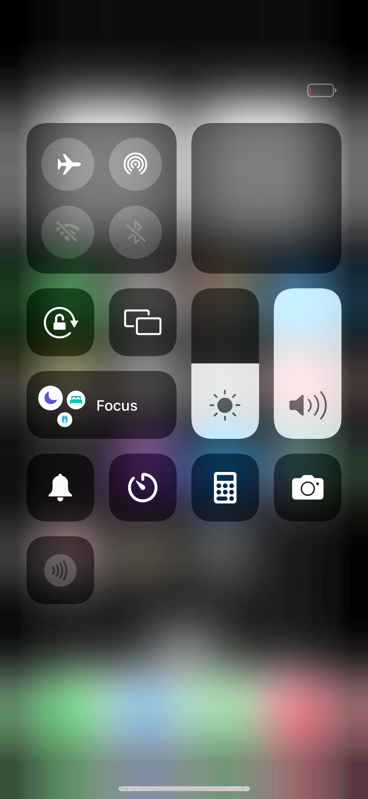
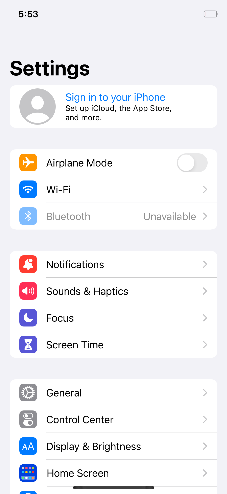
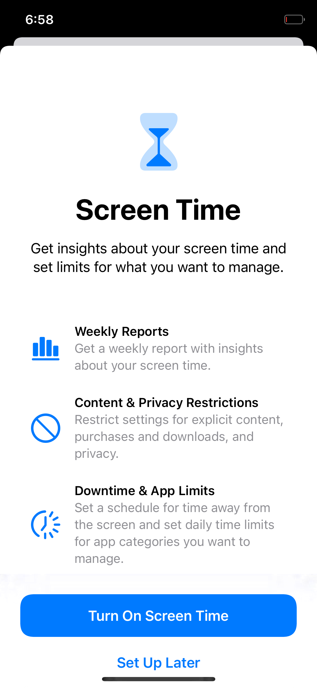

<div align="center">

# IOSVM

**iOS, booting in QEMU on Linux — and operable from a web browser.**

[]()
[]()
[]()
[]()
[](LICENSE)





<sub>All three are the panel of a machine booted by this project: Control Center (backdrop blur and
all), Settings, and Screen Time — the last two reached by **clicking in a browser**.</sub>

</div>

---

## What this is

A Darwin/XNU port that boots Apple's **iOS 16.5 user space** in QEMU on ordinary Linux, draws its
system UI, and lets you drive it from the host: taps, swipes and the software keyboard, through a QMP
control channel and a small web/VNC bridge that this repository carries.

The point is the loop, not the screenshot:

```
    your browser ──► webvnc.py ──► QMP ──► virtio-tablet ──► Darwin's touch driver
         ▲                                                        │
         │                                                        ▼
    JPEG frames ◄── screendump ◄── ramfb ◄── IOMobileFramebuffer ◄── CoreAnimation
                                                       ▲
                                        Mesa softpipe ─┘  (a CPU rasteriser, hence the frame rate)
```

## What works today

| | state | evidence |
|---|---|---|
| boot to the home screen | **yes**, ~8 minutes, about 40 % of attempts (the rest stall inside the port) | [home screen](docs/demo/home-screen.png) |
| tap an icon, launch an application | **yes** | [Settings](docs/demo/settings-app.png) |
| navigate inside an application | **yes** | [Screen Time](docs/demo/screen-time-from-host.png) |
| swipe (home gesture, pull down) | **yes** | [Control Center](docs/demo/control-center.png) |
| operate it from the host | **yes** — QMP, `tools/qemu/tap.py` | [addendum 28](docs/research/linux-kernel-build.md) |
| operate it from a browser | **yes** — `tools/qemu/webvnc.py` | [Focus, by browser click](docs/demo/webvnc-focus-page.png) |
| type text | **yes**, as taps on the software keyboard | [typing `abc`](docs/demo/webvnc-typed-abc.png) |
| networking to the host (LAN) | **yes** — `en0` 10.0.2.15, HTTP both ways | [addendum 30](docs/research/linux-kernel-build.md) |
| names, DNS | no — configd's plugin never registers here | addendum 30 |
| GPU acceleration | no — a CPU rasteriser is what this machine has | — |
| animation smoothness | ~4–7 fps; ~140 ms of Mesa per composited frame | addendum 32b |

`docs/state-of-the-port.md` is the one-page handover view of the same table.

## Quick start

```sh
git clone --recursive https://github.com/lshan99q/iosvm.git
cd iosvm

# 1. Bring your own IPSW — nothing of Apple's is in this repository
tools/unpack-ipsw.sh ~/iPhone10,3,iPhone10,6_16.5_20F66_Restore.ipsw

# 2. Build the kernel, the images and the loader (see docs/ for the pieces)
make

# 3. Boot, and wait until something is actually drawn (it retries: not every boot lands)
tools/qemu/wait-for-ui.sh /tmp/home.png

# 4. Operate it — from a browser…
tools/qemu/qmpmux.py --qmp 4445 --port 4465
tools/qemu/webvnc.py --port 5980 --qmp 4465      # then http://127.0.0.1:5980/
#    …or from a shell
tools/qemu/tap.py 683 1689                      # the Settings icon
```

The tools in `tools/qemu/` are the ones this project actually uses:

| tool | does |
|---|---|
| `wait-for-ui.sh` | boots, retries until a screen is drawn; `KEEP=1` leaves the machine running |
| `tap.py` | a tap or a swipe at panel coordinates, over QMP |
| `qmpmux.py` | QEMU serves one QMP client; this serves many |
| `webvnc.py` | the browser viewer: frames out, clicks and keys in |
| `vncbridge.py` | the same for a VNC viewer instead of a browser |
| `demo.sh` | the whole sequence in one command, a picture of every step |

## How it came to boot

Three things had to be true, and the research note records the measurement behind each:

1. **the display must have a show service** — on a phone the GPU driver starts it; in QEMU nothing
   did, so user-space painting had nowhere to land (`patches/0001`);
2. **`fb_beat` must be 0** — the driver's on-the-beat pacing drops every frame after the first when
   rendering is this slow, which is exactly the "boots to a logo and stops" symptom;
3. **something must send the touch** — a launchd job of ours is not reliably executed here, so the
   synthetic touches come from `/etc/rc`, which `init` runs before it hands process 1 to launchd.

The long version — with the dead ends and three self-corrections —
is [`docs/research/linux-kernel-build.md`](docs/research/linux-kernel-build.md).

## Repository layout

| path | what |
|---|---|
| `patches/` | the changes made to the port: one patch per finding, with the reason |
| `tools/qemu/` | the boot-and-operate tooling above |
| `tools/apfs/` | reading and writing the images without Apple's tools |
| `guest/` | programs that run inside the machine (the painter, `netcfg`) |
| `proto/`, `host/vkbridge/` | GPU transport and its host-side Vulkan backend (submodules) |
| `docs/` | ADRs, the research note, the state of the port, demo screenshots |

## What this is not

- **Not Apple's software.** No kernel, no system image, no dyld cache, no firmware, no font lives
  here. You supply an IPSW you obtained yourself; see `PROVENANCE.md`. Three rules are vetoes: no
  Apple binaries in the tree, no impersonating a device to Apple's servers, no credentials.
- **Not a jailbreak.** The port's own kernel is lenient about code signing by construction (AMFI is a
  stand-in that accepts any parseable signature); nothing here attacks a real device.
- **Not fast.** The renderer is a CPU rasteriser. 24 fps is a target, not a claim: the measured
  ceiling today is about 7 fps of animation.

## Documentation

| | |
|---|---|
| [`docs/state-of-the-port.md`](docs/state-of-the-port.md) | one page: what works, what does not |
| [`docs/research/linux-kernel-build.md`](docs/research/linux-kernel-build.md) | the long note: every measurement, and the mistakes |
| [`docs/architecture.md`](docs/architecture.md) | how the pieces fit |
| [`docs/phases.md`](docs/phases.md) | milestones, one acceptance command each |
| [`docs/adr/`](docs/adr) | the decisions, with their evidence |
| [`docs/zh/`](docs/zh) | Chinese translations |

## License

MIT for this project's code (`LICENSE`); Apple's open-source XNU keeps its APSL
(`LICENSE.APSL`), and the GPL-2.0 parts (`LICENSE.GPL2`) stay GPL-2.0. See `NOTICE`.
