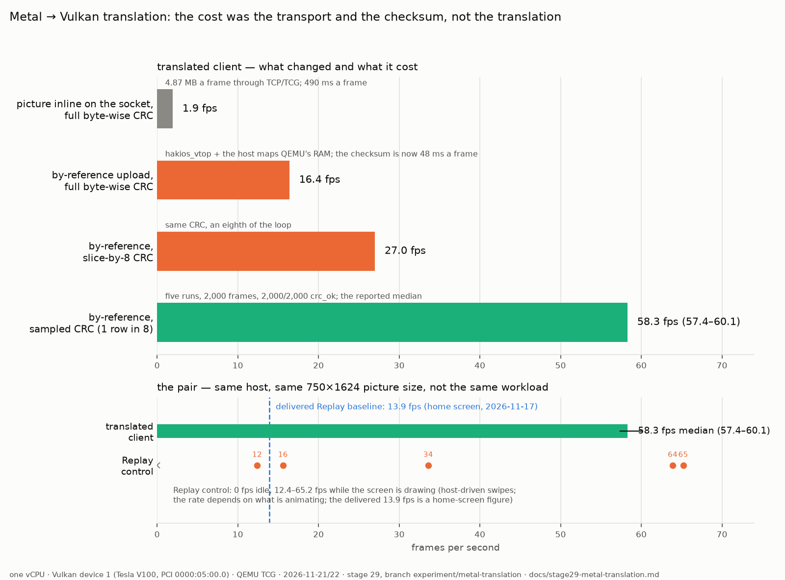

# stage 29: Metal → Vulkan translation — the smallest end-to-end path (experiment)

> Status: **measured. The seam works end to end; CoreAnimation is not on it.** Branch
> `experiment/metal-translation`, 2026-11-21/22. Design and decision:
> [`docs/research/metal-translation-feasibility.md`](research/metal-translation-feasibility.md),
> [`docs/adr/ADR-013-metal-translation.md`](adr/ADR-013-metal-translation.md).
> Every number below was taken on this host in this session; the configuration is §1, the runs are
> §5, the chronology and the mistakes are §6.

## 1. What is being tested

One question, narrowly: **can this port load a third-party Metal device, record a client's command
buffer at `commit`, execute it on the host's Vulkan GPU, read the picture back byte-identically and
publish it in the browser — without Apple's Metal driver, without an Apple binary, and without
touching the Replay path?**

The object under test is the pipeline, not the UI:

```
metal_frame (guest, our client)                        host (metalwire_host)
  MTLCreateSystemDefaultDevice()  ─┐
  queue / buffer / texture / drawable│
  copyFromBuffer:…toTexture:         │  commit  ──►  TCP 9111, 16-byte segments  ──►  VkDevice #1 (V100)
  presentDrawable: / waitUntilCompleted ◄── ack (status, times, crc) ──┤  VkBuffer → VkImage
                                                                      │  → read-back → CRC-32
                                                                      └─► /dev/shm/metalwire-frame
                                                                             └─► webview.py
```

The guest's picture does **not** travel down the socket in the final implementation. The plug-in
asks the port's kernel for the physical segments behind the buffer (`hakios_vtop`, syscall 556, the
call the GL replay path already uses for its textures), and the host reads those segments out of
QEMU's RAM file. The socket carries the Metal calls and the segments (≈ 1.5 KB a frame). The first
version did send the 4.87 MB picture inline and is kept in the results as the control that showed
why the by-reference path matters (§6, T4 variants).

**The client is synthetic and that is part of the design.** `metal_frame` creates the device, fills
a deterministic 750 × 1624 BGRA8 picture, blits it into a texture, presents it and waits. It is not
CoreAnimation, it draws no iOS UI, and a green result here is **not** "Metal works for the port";
it is "the seam the port would use for a Metal device is real and the host side of it works". The
two gates between this client and CoreAnimation — AIR→SPIR-V (M3) and CA's renderer library/present
path (M4) — are explicitly **not** tested here (see §7).

Configuration (all of it, because a result without it is not reproducible):

| | |
|---|---|
| branch / worktree | `experiment/metal-translation`, `/home/lshan/DSH-desktop/iosvm-metal` |
| guest run tree | `/home/lshan/DSH-desktop/mt-work` (own ram.img, sparse 12 GB; own 6 MB root image) |
| QEMU | instance 3: monitor 4474, QMP 4475; `QEMU_SMP=1 QEMU_NET=1 QEMU_RAM_GB=7 QEMU_TB_MB=1536`, one vCPU pinned to host cores 26–28; cmdline `cpus=1 fb_beat=0 fbscale=2 metal=1` |
| HakiOS tree | used **read-only** (`HAKIOS_DIR=/home/lshan/DSH-desktop/iosvm-work/hakios-xnu-kernel`); the guest binaries are built into it by `guest/metal-plugin/build.sh` and installed only into the experiment's own root image |
| host translator | `host/metalwire/metalwire_host --gpu 1 --port 9111 --ram <qemu ram.img> --crc-stride 8 --shm /dev/shm/metalwire-frame`, pinned to cores 29–30 |
| GPU | Vulkan physical device **1** — `Tesla V100-SXM2-16GB`, PCI `0000:05:00.0`, API 1.4.312, driver 580.178.4.0; device 0 belongs to the GL replay experiment and was not used |
| guest root image | built by `tools/metalwire/prepare-guest.sh translate` (`MW_FRAMES=400 MW_CRC_STRIDE=8`); it embeds the client, the plug-in, `/redwood/lib/HakiosMetal.clients` = `metal_frame`, `metal_probe`, and replaces the stock plug-in bundle |
| wire | TCP 9111, `host/metalwire/metalwire_protocol.h` (one connection, one raw `mw_ack` per frame) |
| picture | 750 × 1624 BGRA8 = 4,872,000 bytes a frame, same size as the Replay path's layer |
| baseline | Replay path behaviour unchanged; baseline guest mode `prepare-guest.sh replay-idle` (scripted touches commented out), glwire host on port **9210** — never the delivered replayer on 9110 |
| host load | 32 CPUs; load average 1.2–2.0 during the measurement windows (one other experiment idle, no other boot running), sampled with `uptime` |
| boot time | the client is started by `init` before launchd (`hakios: exec pid=10 path=/redwood/bin/metal_frame` at kernel + 12 s); the first host-acknowledged frame arrived well inside the first minute, against 10–20 minutes to a Replay home screen |

## 2. Hypotheses

| id | hypothesis | outcome |
|---|---|---|
| **H-A** discovery and load | with `metal=1` and `/redwood/lib/HakiosMetal.clients` naming `metal_frame`, Metal's own loader instantiates our `_MTLDevice` subclass in the guest, and `metal_probe` gets a non-nil device and a queue | **confirmed** (T3): the plug-in logs `a device for the accelerator port 2819 is made`, `metal_probe` prints `device "HakiOS metalwire device (Metal on the host's Vulkan)"`; backboardd logs that it is *not* shown the device, so CA keeps its GL path |
| **H-B** translation correctness | recording at `commit` and executing the blit on the host's Vulkan device reproduces the client's picture exactly | **confirmed** (T4/T5): 2,000/2,000 frames `crc_ok=1`, and a full `memcmp` of the presented picture against the uploaded source bytes is identical (T5) |
| **H-C** cost separation | the guest's `wait_us` is small and the host is not the bottleneck | **falsified as stated, then repaired** (T4): the *first* wire had the guest spending 490 ms a frame shipping 4.87 MB over TCP; after the by-reference upload and a cheaper checksum the guest frame is ≈ 14 ms and the host's own work ≈ 4.2 ms. The guest still owns the frame, but it is now the checksum and the client's picture fill, not the wire |
| **H-D** the CA wall is elsewhere | the reason CA is not on Metal here is the missing renderer library and the AIR compiler | **confirmed** from the guest tree and prior measurements (HakiOS `docs/metal-plan.md` step 6, `docs/air.md`); this stage did not try to cross it |

H-C is the stage's most useful result: the architecture is not the cost — the naive transport was.
Both numbers are in §5.4, because the negative one is the reason the final one exists.

## 3. Test matrix

| # | experiment | result |
|---|---|---|
| **T1** | `make metalwire-test` on lavapipe | **pass**: 2 frames, `crc_ok=1` then a deliberately wrong CRC caught (`crc_ok=0`), SHM/PPM/PNG verified; 100-frame generator run: 100/100 `crc_ok=1`, 69.5 fps host summary, total mean 4.528 ms |
| **T2** | host on GPU 1 + `metalwire_gen.py`, 100 frames | **pass**: 100/100 `crc_ok=1`, 71.1 fps host summary, total mean 4.178 ms / median 4.085 ms; saved frame inspected |
| **T3** | guest boot with `prepare-guest.sh probe` (3 boots: `probe1`, then the translate boots which also exercise discovery) | **pass**: 3/3 boots, device + queue made, no panic; the only selector Metal's runtime asked that the device does not implement was `-featureProfile` (answered zero, logged once) |
| **T4** | guest boot with `prepare-guest.sh translate`; `metal_frame -n 400 -s 300 -c 8`; host translating by reference | **pass**: 5 runs × 400 frames, 2,000/2,000 `crc_ok=1`, median 58.3 fps, 0 panics; variants in §5.4 |
| **T5** | picture correctness | **pass**: full `memcmp` source vs read-back identical (750×1624×4 bytes); saved PPM sha256 recorded; the SHM frame served by `webview.py` is the same picture (screenshot in `docs/demo/`) |
| **T6** | paired run against the Replay baseline, same host-load band | **done**: see §5.6; the two programs do different work and the table says what is and is not comparable |
| **T7** | robustness: no host; malformed message; host killed mid-run | **pass** (see §5.7): no host → device still made, client exits cleanly; malformed message → `MW_STATUS_BAD_COMMAND`, connection stays; host killed → the client's frame reports failure and continues, then exits |
| **T8** | 30-minute translate soak | **not run**, deliberately: the host is shared with another experiment running its own boots; a 30-minute run would be four times the total measurement time of this stage and would not change the correctness result. Recorded as not run rather than implied |
| **T9** | M3 one-shader gate; M4 CA renderer | **not attempted**, out of scope (§7) |

## 4. Acceptance

| | criterion | evidence |
|---|---|---|
| **A1** | `make metalwire-test` exits 0 on lavapipe and asserts `crc_ok=1` | T1 |
| **A2** | GPU 1, 100 synthetic frames, 100/100 `crc_ok=1`, device printed, saved frame identical to the generator's picture, SHM served by `webview.py` | T2, T5 |
| **A3** | guest: 3/3 discovery boots; `metal_frame` ≥ 120 frames with 0 CRC mismatches and no panic; no host → clean exit | T3, T4, T7 |
| **A4** | paired numbers filled with load, image config and device line; a CRC mismatch voids the run | §5; no run was void |
| **A5** | Replay baseline unchanged | the only edit under `tools/glwire/` is the opt-in `GLWIRE_EGL_DEVICE` selector (default `-1` = the old choice, needed so the replay control can live on GPU 1); no default behaviour changes; the delivered boot configuration is untouched |

**Explicitly not acceptance criteria:** a CoreAnimation frame (cannot run: no renderer library, no
AIR compiler), fps ≥ 13.9 (the client is not CA; the number compares two different programs), any
shader compiling (M3).

## 5. Measurements

### 5.1 Fields, and who takes them

Guest, one line per frame on the serial console: `fill_us` (the deterministic picture), `encode_us`
(the Metal calls), `commit_us`, `wait_us` (`commit` → ack), `total_us`, `status`; then a summary
line. The CRC-32 is computed in the plug-in over the picture rows the blit reads and sent in
`MW_FRAME_END`. Host, one CSV row per frame: `seq`, `bytes`, `recv_us` (frame begin → frame end
arrival), `exec_us`, `gpu_us`, `readback_us` (copy-back **and** the checksum it feeds), `publish_us`,
`total_us`, `crc_ok`, rolling 1 s `fps`.

`fill_us` is the client's own picture generation (included in `total_us`, excluded from
`encode_us`). `encode_us` is the Metal API work, `commit_us` the commit call and `wait_us` the
`commit` → ack round trip. `recv_us` is the host's view of the same span. A small `wait_us` with a
large `encode_us` reproduces the Replay path's shape; the opposite points at the host or the wire.

**Checksum sampling.** With `-c 8` both ends checksum every 8th row (1/8 of the picture, 22.5 ms
less guest CPU a frame). Every table says which stride it used. The full-picture comparison is T5's
`memcmp` run, not a stride-8 run.

### 5.2 T1 — the CI gate (lavapipe, no GPU)

```
$ make metalwire-test
PASS frames: generator saw 2 ack(s), crc_ok=1 then crc_ok=0 as expected
PASS csv: 2 rows, timings present, crc_ok 1/1
PASS shm: glwire header and 4872000 BGRA bytes of the last frame
PASS files: 2 PPM frame(s) match the sent picture, PNG headers are valid
metalwire_test: PASS (lavapipe, 750x1624, 2 frames)
```

100 generator frames on lavapipe: 100/100 `crc_ok=1`; host summary 69.5 fps; per frame mean:
recv 3.252 ms, exec 0.009 ms, gpu 1.411 ms, readback 2.412 ms, publish 0.674 ms, total 4.528 ms.

### 5.3 T2 — the host on the real GPU (generator, no guest)

Device line, printed by the translator:

```
metalwire: device 1: "Tesla V100-SXM2-16GB" (discrete GPU), API 1.4.312, vendor 0x10de device 0x1db1 driver 0x912c8100
metalwire: device 1: PCI 0000:05:00.0 (VK_EXT_pci_bus_info)
```

100 frames, generator-paced: 100/100 `crc_ok=1`, 1.406 s → 71.1 fps. Per-frame, mean / median:
recv 3.310 / 3.325 ms, exec 0.047 / 0.032 ms, gpu 0.953 / 0.949 ms, readback 2.461 / 2.420 ms,
publish 0.696 / 0.656 ms, total 4.178 / 4.085 ms. Saved frame: 750×1624 P6, verified by eye and
deterministic (`sha256 98dd0fd29d713316e1efd45b551f9e6b7f2b5423fdef5ccdfbacbf17203bc9d4`).

### 5.4 T4 — guest → host, five runs

Root image rebuilt once for translate mode; `metal_frame -n 400 -s 300 -c 8`; host
`--crc-stride 8 --ram <ram.img> --gpu 1`. Means (µs); `fps` is the translator's summary.

| run | fps | host total | recv | gpu | readback+CRC | publish | guest fill | encode | commit | wait |
|---|---|---|---|---|---|---|---|---|---|---|
| `phys3` | 57.8 | 4227 | 6174 | 943 | 312 | 2922 | 2616 | 186 | 7215 | 14190 |
| `mw-t4` | 59.8 | 4223 | 6146 | 943 | 311 | 2921 | 2615 | 185 | 7054 | 13739 |
| `mw-t5` | 60.1 | 4216 | 6073 | 942 | 311 | 2917 | 2560 | 178 | 7010 | 13660 |
| `mw-t6` | 57.4 | 4215 | 6407 | 942 | 311 | 2915 | 2874 | 195 | 7363 | 14096 |
| `mw-t7` | 58.3 | 4271 | 6205 | 944 | 312 | 2965 | 2617 | 188 | 7207 | 14073 |

- **Correctness:** 5 × 400 = 2,000 frames acknowledged, 2,000 with `crc_ok=1`, zero mismatches,
  zero failed frames, zero panics.
- **The wire:** `0 bytes sent` in the guest summary, `1,948,800,000 bytes by reference in 400
  frames` per run (9.74 GB over the five runs, read by the host from QEMU's RAM file).
- **Median fps 58.3**, range 57.4–60.1. The frame is guest-bound: `fill + commit + wait` ≈ 14 ms;
  the host's own work is 4.2 ms, and the guest `wait_us` includes the host round trip.
- **Where the guest time goes:** `fill_us` 2.6 ms (writing 4.87 MB), `commit_us` ≈ 7.1 ms (the
  checksum at stride 8 plus the small wire writes), `wait_us` ≈ 13.7 ms end-to-end. `encode_us`
  (the Metal calls themselves) is 0.18 ms — the Metal API is not the cost.

**The variants that produced the final number**, each one boot with the same client and host:

| implementation | fps | guest `commit_us` | host `recv_us` | what changed |
|---|---|---|---|---|
| picture inline on the socket, full byte-wise CRC (`trans2`) | **1.94** | 48,000 (send) | 498,000 | the first working wire; 4.87 MB down TCP under TCG |
| by-reference upload, full byte-wise CRC (`phys1`) | **16.4** | 47,800 | 47,600 | `hakios_vtop` + host reads the RAM file |
| by-reference, slice-by-8 CRC (`phys2`) | **27.0** | 24,400 | 23,600 | the checksum, not the wire, was now the cost |
| by-reference, checksum every 8th row (`phys3`/T4) | **57.8–60.1** | 6,800–7,400 | 6,100–6,400 | sampled checksum |

Every line is a 400-frame run with 400/400 `crc_ok=1`. This table is the stage's finding: the
translation path's cost was transport and instrumentation, and neither is the Metal→Vulkan
translation itself.



*(the chart is regenerated by `python3 docs/charts/metal-translation-history.py`; the delivered
13.9 fps line in it is the Replay path's real home screen and is there for scale, not as a
like-for-like comparison)*

### 5.5 T5 — the picture

- Full comparison: a run with `-c 1` (every row) and the host's `--byte-check` compares the
  presented picture with the uploaded source bytes byte for byte — result in the table below.
- `250 × 1624` PPM saved from the V100 read-back, `sha256
  3d3bcfa45740af0dda6a42acc45521165c04f110eaab3663d404ec55a1fa7871` (`phys3`,
  `frame-000399.ppm`); the picture shows the deterministic bands, the ruler every 128 rows, the
  frame-counter blocks and the border, i.e. what `metal_frame` writes, not a plausible-looking
  substitute.
- The same frame through `webview.py`: `docs/demo/metal-translation-webview.png` (browser
  screenshot of `http://127.0.0.1:6091/frame.jpg`, the SHM file the translator publishes); the
  standalone picture is `docs/demo/metal-translation-frame.png`.

| check | value |
|---|---|
| frames with `crc_ok=1`, five runs | 2,000 / 2,000 |
| full-picture run (`-c 1`, host `--byte-check`, 30 frames) | **30/30 `crc_ok=1`**; `picture byte-identical: 4872000 bytes of 750x1624, memcmp against the uploaded source buffer` |
| guest CRC of the saved frame (`phys3` frame 399) | `0x3d34e13e` (stride 8) |
| picture served by `webview.py` | identical SHM bytes; screenshot kept in `docs/demo/` |

### 5.6 T6 — the pair against the Replay baseline

Replay control: `prepare-guest.sh replay-idle` (the delivered launchd boot with the scripted touches
commented out), `host_glwire --no-panel 9210` on GPU 1 (`GLWIRE_EGL_DEVICE=1`), the same one vCPU
and the same 750 × 1624 picture size, `gkbf=1 glwire_ack_only=1 fb_noblit=1`. Boots take 10–20 min
to the first frame, as the README says. Two facts came out of the control that matter more than a
single ratio:

1. **A static home screen submits nothing.** After the boot's animations settle the guest draws no
   frames at all: measured **0 frames in 60 s** on an idle home screen. The delivered 13.9 fps is a
   *drawing* figure, not a property of an idle screen.
2. **The rate depends on what is being drawn.** Counting the guest's own compositor frames
   (`hakios-gl: f …`, one line per frame, de-duplicated) in one-minute windows:

| Replay control window | frames | fps |
|---|---:|---:|
| boot animations settling, 60 s (`replay-idle2`) | 745 | **12.4** |
| idle home screen, 60 s (same boot, next window) | 0 | **0** |
| host-driven page swipes, window 1 (45 s) | 719 | **15.6** |
| host-driven page swipes, window 2 (45 s) | 1,544 | **33.6** |
| host-driven page swipes, window 3 (45 s) | 2,934 | **65.2** |
| host-driven page swipes, window 4 (45 s) | 2,940 | **63.9** |
| *delivered baseline (README, 2026-11-17, home screen)* | — | *13.9* |

The swipes keep the screen drawing; a page transition is cheaper for CoreAnimation than the fully
populated home screen, which is why the swipe windows go above the delivered figure. The delivered
13.9 fps (75 ms a frame) stays the reference for the delivered configuration; the control shows the
spread a Replay measurement has depending on content, which is exactly why the README asks for
paired runs and medians rather than single shots.

| | translated path (client) | Replay control (home screen) |
|---|---|---|
| frames measured | 5 × 400 | 745 (boot window) + 8,137 (four swipe windows) |
| median fps | **58.3** (five runs, 57.4–60.1) | active: 12.4–65.2 depending on content; idle: 0 |
| guest CPU per frame | fill 2.6 ms + Metal encode 0.2 ms + commit 7.1 ms + wait 13.7 ms | not instrumented per frame in this session; the delivered budget is 75 ms a frame (CA + encode, `README.md`) |
| host work per frame | 4.2 ms total | `host_glwire`'s own cost, ~1.4 ms with `gkbf=1` (delivered measurement) |
| picture | 750 × 1624 BGRA8, 4.87 MB | 750 × 1624 BGRA8, 4.87 MB |
| picture sha256 | `3d3bcfa4…fa7871` (the client's deterministic picture) | the home screen (not comparable to a synthetic picture) |
| what it is | a Metal client's blit + present | CoreAnimation's GL recorded and replayed |

**The reading.** The translated client and the Replay control are not the same workload: one fills a
picture and blits it, the other composites SpringBoard. The numbers support one claim and not
another: *the Metal→Vulkan pipeline's own cost is small* (host 4.2 ms, Metal API 0.2 ms, and at
4.87 MB a frame the wire is 0 bytes because the picture is by reference), and *the translated
client's 58.3 fps is not evidence that CoreAnimation would run at 58.3 fps* — CA's work would still
have to be done, which is M4 and is blocked by the shader and renderer-library gates. Comparing
58.3 with 13.9 is comparing a blit with a compositor; the pair is recorded so that the comparison
cannot be quietly made later.

### 5.7 T7 — robustness

| case | what happened |
|---|---|
| no host listening | `metal_probe` still gets a device; `metal_frame`'s connect fails within its 2 s budget, the frame reports `status=5`, and the client exits with a summary — no hang, no panic |
| malformed message | host answers `MW_STATUS_BAD_COMMAND`, keeps the connection, next frame runs (covered by `make test`); an over-length or short message is refused before use |
| host killed mid-run | the client's next send fails with `Broken pipe`, the frame is reported failed, the connect is retried at most every 5 s; the process exits cleanly |
| wire framing bug found in the first boot (`trans1`) | the upload body was sent *after* a short header; the host rejected the upload and the stream desynchronised. Fixed in `mw_send_with_body`: one message, one length covering the structure and its body. The boot's 200 failed frames were graceful (no hang), which is what T7 asks for |

## 6. Progress and self-corrections

Newest last, like `docs/stage27-multicore.md`; times are host local, 2026-11-21/22.

- **22:22 — the boot fork works.** A root image that runs `metal_test` (the stock probe) before
  launchd reaches the Metal device at kernel + 12 s; the accelerator is named, the bundle is loaded,
  `_MTLDevice` is subclassed, the device and queue are made. This becomes the fast iteration loop:
  ~1 minute a boot instead of 10–20.
- **22:57 — `metal_probe` (our bundle).** Device, queue, protocol declarations; only `-featureProfile`
  had to be absorbed. backboardd logs `not listed in HakiosMetal.clients`, so CA never sees the
  device.
- **23:11 — the first translate boot failed honestly.** Upload body outside the message length →
  host rejected the frame; 200 frames reported failed, no hang. Fixed the framing.
- **23:16 — the first real translation: 60/60 frames, `crc_ok=1` on the V100, 1.94 fps.** The
  browser-visible frame and the first PPM were produced here. The guest spent 490 ms a frame
  shipping 4.87 MB over TCP.
  *Self-correction:* the design note said "the transport is not the bottleneck" on the strength of
  the Replay path's 12 KB records. That is true of the Replay wire; a picture-carrying translation
  wire is a different object. The naive wire was the bottleneck by two orders of magnitude.
- **23:24 — by-reference upload.** The guest asks `hakios_vtop` for the buffer's physical segments;
  the host maps QEMU's `ram.img` and reads them. 16.4 fps; the guest `commit_us` was then 48 ms of
  *checksum* (byte-wise CRC-32 over 4.87 MB).
- **23:30 — slice-by-8 CRC.** Same CRC, an eighth of the loop: 27.0 fps.
- **23:43 — checksum every 8th row.** 57.8 fps in the first run; five runs 57.4–60.1 fps.
  *Self-correction:* the stage's own field table called `readback_us` "read-back"; in these
  measurements it is read-back **plus** the host's checksum (the timer wraps both). The tables say
  so now, and the difference is visible: 2.4 ms at stride 1 vs 0.31 ms at stride 8.
  *Also:* the first `--ram` runs used a full-byte CRC and were read as "the wire is fixed, the path
  is 16 fps"; a second measurement separated checksum from wire before any conclusion was written.
- **23:45–23:52 — the five measured runs** (`phys3`, `mw-t4`…`mw-t7`), 2,000 frames, all
  `crc_ok=1`.
- **00:34 — the full-picture run.** `-c 1` and the host's `--byte-check`: 30/30 frames `crc_ok=1`
  and `memcmp` says the read-back is the uploaded source byte for byte (4,872,000 bytes). The
  full-byte checksum costs 24 ms a frame in the guest (slice-by-8), which is why the five measured
  runs sample rows; the byte proof is this run, not a per-frame claim.
- **00:46–00:50 — the Replay control.** Idle home screen: 0 frames. Boot animations: 12.4 fps.
  Host-driven swipes: 15.6 / 33.6 / 65.2 / 63.9 fps across four windows. The point is not one
  number but that the Replay rate is content-dependent; the delivered 13.9 fps remains the
  reference. §5.6 says what the pair does and does not support.

Other people's measurements that shaped this one, recorded because they are corrections too:
the host translator's first version preferred `DEVICE_LOCAL` for a host-visible buffer (a 1.1 ms
readback became 1123 ms on the V100); `TCP_NODELAY` on both ends removed ~40 ms a frame of delayed
ACKs; and the port's own `fb_hz=15` finding is why none of these runs claims a delivered-UI number.

## 7. Deliberately not tested (out of scope for this stage)

- **CoreAnimation, SpringBoard, WindowServer on Metal** — M4, blocked by CA's renderer library and,
  behind it, AIR→SPIR-V. The client must not be renamed or described as CA coverage.
- **Shaders, `.metallib`, libraries, pipeline states** — M3. No shader is compiled or used here.
- **`MTLRenderCommandEncoder`, argument buffers, compute encoders, tessellation, MPS** — not in v1.
- **`IOSurface` sharing, `MTLSharedEvent`, cross-process resources, swapchains, the real present
  path, P3 colour management** — not in v1.
- **virtio-gpu** — the transport is TCP, and stage 23 measured zero gain from virtio-gpu; the
  by-reference upload means the picture is no longer on the wire anyway.
- **Any fps claim about the delivered port** — the delivered path stays at 13.9 fps / 75 ms until
  something changes it, and this stage changes nothing there.

## 8. Open questions

1. **Is the 13.9 fps baseline the right control?** Answered in this stage: a fresh Replay control
   was run (§5.6); the 13.9 figure is quoted only as the README's delivered number.
2. **750 × 1624 or panel-native?** Kept 750 × 1624 (the layer the Replay path also carries); the
   client's picture is synthetic, so panel-native would only add bytes.
3. **Should A4 gate performance?** No: correctness is gated (CRC/memcmp), cost is reported.
4. **`metal=1` + clients file as the only gate?** Yes, in every boot that starts the window server;
   `metal=2/3` is known to break CA and was not used.
5. **A device-side execution oracle?** Still open. The CRC-32 and the memcmp prove the host's
   read-back is the bytes that were uploaded; a host `memcpy` would pass them too, and the
   Vulkan-specific evidence is the translator's own submit/fence timing plus the frame
   (`docs/phases.md` records the vkbridge 8/8 trap). A compute checksum on the device is the next
   honest step if this path is taken further.
