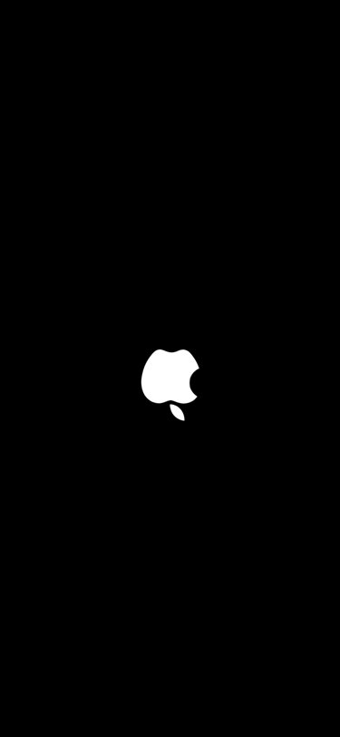

# stage 33: the picture — protocol 3, real IOSurface, CoreAnimation's BootUI frame

> Status: **measured. CoreAnimation's recorded render encoder is now a picture**: the two per-draw
> buffer-offset setters and texture `replaceRegion:` content are on the wire (protocol 3), the
> display texture is a real IOSurface whose ~300 physical segments the host reaches through QEMU's
> RAM file, and the browser's JPEG stream shows the BootUI Apple logo. 0 Khronos `VUID` with the
> validation layer loaded. Branch `iosvm`, 2026-11-22. This carries out WP-3 of ENG-METAL-004 and
> continues [`docs/stage32-ca-metal-execute.md`](stage32-ca-metal-execute.md).



## 1. What changed

### Wire (protocol 3)

`MW_VERSION` is 3. The host accepts 2 and 3, and every ack echoes the version the peer opened with,
so the v2 synthetic client's ack parser is unchanged. No v2 message changed shape.

| opcode | meaning |
|---|---|
| `MW_RENDER_SET_VERTEX_BUFFER_OFFSET` 0x0076, `..._FRAGMENT_BUFFER_OFFSET` 0x0077 | `-setVertexBufferOffset:atIndex:` / `-setFragmentBufferOffset:atIndex:`: replace the offset of the buffer already bound, as Metal documents |
| `MW_TEXTURE_REPLACE_REGION` 0x0022 | `-replaceRegion:mipmapLevel:withBytes:bytesPerRow:` and its `slice`/`bytesPerImage` sibling; bytes inline |
| `MW_TEXTURE_SET_IOSURFACE` 0x0023 | the guest-physical segments behind a texture's real IOSurface |

### Guest (`guest/metal-plugin/HakiosMetal.m`)

* The two offset setters are class methods now, recorded as `MWR_OP_SET_*_BUFFER_OFFSET` and
  serialized as protocol-3 messages. They count as sets (CA's set_count goes 13 → 16/17).
* Textures implement `replaceRegion:...`: the bytes are copied out and carried on the wire in the
  frame that first names the texture. Both the BGRA8 layer image and the 128×1 R8Unorm luma ramp go
  through the same path; `bytes_per_row` is kept (516 for the 129-wide image, 128 for the ramp).
* `newTextureWithDescriptor:iosurface:plane:` records the surface's base address, stride and
  allocation size (dlsym'ing `IOSurfaceGetBaseAddress` / `GetBytesPerRow` / `GetAllocSize`). When
  the texture is first named in a frame the plug-in touches one byte per 16 KiB page (faults the
  mapping in), asks `hakios_vtop` for the physical runs and sends them. A surface whose pages are
  not resident, or a kernel without the call, sends `segment_count = 0`: the host then uses its own
  read-back, so the new path degrades instead of failing.

### Host (`host/metalwire/metalwire_host.c`)

* Decodes the three new messages. Offset setters update the current encoder binding; a draw copies
  the state it sees, exactly like the other setters.
* Queues `replaceRegion:` bytes and uploads them to the Vulkan image (host-visible staging →
  `vkCmdCopyBufferToImage`) before the first draw of the frame; `bufferRowLength` is the wire's
  stride in texels, which covers R8Unorm (1 byte/texel) and BGRA8/RGBA8 (4).
* Keeps an IOSurface-backed texture's segments. After the draws it copies the tight read-back into
  the surface's row-padded layout (stride 3072 or 3008, not 750×4), then reads the same bytes back
  out of QEMU's RAM file and publishes **that** memory to the browser. `--ram` is opened read/write
  for this; a read-only RAM file falls back to the Vulkan read-back.
* `--out DIR` now also saves render frames, and `--png-every` writes the diagnostic PNGs for them.

## 2. Evidence (lavapipe; `--gpu 1`)

Configuration: host `metalwire_host --gpu 1 --port 9111 --ram mt-work/hakios/qemu/ram.img --shm
/dev/shm/metalwire-frame --out /tmp/wp3-frames --png-every 1`; guest run by
`tools/metalwire/run-guest.sh` (QEMU instance 3, one vCPU), `MW_CMDLINE="cpus=1 fb_beat=0
fbscale=2 metal=1"`, clients `metal_frame`, `metal_probe`, `backboardd`; boot tags `ca-metal-wp3b`
(validation off) and `ca-metal-wp3val` (validation on). V100 `0000:05:00.0` was not touched.

### Guest: the setters and the textures are recorded

```
metalwire: newTextureWithDescriptor:iosurface:plane: IOSurface 1 (...) -> texture 40 (750x1624);
    surface base 0x105b94000, row 3072, 4997120 byte(s) (real: ...)
metalwire: CA texture: replaceRegion:mipmapLevel:slice:withBytes:bytesPerRow:bytesPerImage:
    texture 43: 129x158 at 0,0 level 0 row 516 image 0 (81528 byte(s); content on the wire, serial 1)
metalwire: CA set: setVertexBufferOffset:576 atIndex:1
metalwire: CA texture: replaceRegion:mipmapLevel:withBytes:bytesPerRow:
    texture 46: 128x1 at 0,0 level 0 row 128 (128 byte(s); content on the wire, serial 1)
metalwire: CA set: setFragmentBufferOffset:784 atIndex:1
metalwire: CA set: setFragmentBufferOffset:1024 atIndex:2
metalwire: CA set: setVertexBufferOffset:1056 atIndex:1
metalwire: texture 40: IOSurface 1 4997120 byte(s) in 305 physical segment(s), row 3072;
    the host can reach every byte
...
metalwire: CA set: setVertexBufferOffset:576 atIndex:1
metalwire: CA set: setFragmentBufferOffset:780 atIndex:2
metalwire: CA set: setVertexBufferOffset:816 atIndex:1
metalwire: texture 48: IOSurface 2 4898816 byte(s) in 299 physical segment(s), row 3008
```

`grep -c 'asked and not implemented: -\(setVertexBufferOffset\|setFragmentBufferOffset\|replaceRegion\)'`
is **0**. The three remaining "asked" lines are unrelated Metal SPI (`featureProfile`,
`setGPUPriority:`, `setProtectionOptions:`), unchanged by this stage.

### Host: the recorded geometry reaches the draws

The second frame is exactly the geometry WP-2 could only infer — quads at 336/576/816, indices at
528/768/1008:

```
metalwire: CA draw: geometry: index 49 at 528 v1=336 v2=240 f1=0
metalwire: CA draw: geometry: index 49 at 768 v1=576 v2=240 v3=544 f1=0 f2=540
metalwire: CA draw: geometry: index 49 at 1008 v1=816 v2=240 v3=544 f1=0 f2=780
```

The first frame of the same boot carries an extra pair of setters (`f1=784`, `f2=1024`,
`v1=1056`, index 1248): CoreAnimation records what it records, and each draw executes the state
that preceded it. That is the point of the opcode; the inferred table in the WP-2 note was one
frame's worth, not a universal constant.

### Host: the picture

```
metalwire: render: texture 40: real IOSurface, row 3072, 4997120 byte(s) in 305 physical segment(s)
metalwire: render: texture 43: replaceRegion 129x158 at 0,0 row 516 (81528 byte(s)) queued
metalwire: render: texture 46: replaceRegion 128x1 at 0,0 row 128 (128 byte(s)) queued
metalwire: render frame 1: executed 3 draw(s) on texture 40 (750x1624), crc 0xa51062ee,
    1257162/4872000 non-zero byte(s)
metalwire: render: picture written into the guest's real IOSurface and read back by reference
    (4872000 byte(s), 305 segment(s), row 3072)
metalwire: render frame 1: 1 encoder(s), 3 draws, 17 sets, target texture 40 750x1624,
    status 0 (executed on Vulkan)
metalwire: render frame 2: executed 3 draw(s) on texture 48 (750x1624), crc 0xa51062ee,
    1257162/4872000 non-zero byte(s)
metalwire: render: picture written into the guest's real IOSurface and read back by reference
    (4872000 byte(s), 299 segment(s), row 3008)
metalwire: render frame 2: 1 encoder(s), 3 draws, 16 sets, target texture 48 750x1624,
    status 0 (executed on Vulkan)
```

`1,257,162` non-zero bytes is the Apple logo, not WP-2's 1,218,000-byte opaque black rectangle: the
image texture and the R8 ramp are real content. Frames are in `/tmp/wp3-frames/frame-00000{0,1}.{ppm,png}`;
the picture above is a 375×812 reduction of frame 1.

Browser path: `python3 tools/glwire/webview.py --port 9211 --shm /dev/shm/metalwire-frame` serves
`http://127.0.0.1:9211/`; `GET /frame.jpg` returned a 12,791-byte, 562×1218 JPEG of the same
Apple logo (scale 0.75, quality 62). The SHM file is the picture the host read back out of the
guest's IOSurface, not the Vulkan read-back.

### Validation

Same boot with `VK_INSTANCE_LAYERS=VK_LAYER_KHRONOS_validation` (loader debug confirmed
`Insert instance layer "VK_LAYER_KHRONOS_validation"`): both render frames executed with status 0
and the host log contains **0** `VUID` lines. The four-shader pipeline set, dynamic rendering,
descriptor writes, IOSurface read/write and the texture uploads are all on this path.

### Regressions

* `make test` in `host/metalwire/`: **PASS** (lavapipe, v1 blit: 2 frames, CRC ok/mismatch as
  expected, CSV, SHM, PPM/PNG).
* Synthetic v2 client: `metalwire_gen.py 750 1624 --frames 60` → **60/60 acknowledged, crc_ok=1**
  on every frame. The host echoes version 2 in those acks.
* The WP-2 render spike path still executes (`metalwire_gen.py --render`, 3 draws, status 0).

## 3. What the picture is — and what it is not

* **It is the BootUI frame.** `backboardd` is the process that sees the Metal device; its
  CoreAnimation renderer draws the boot Apple logo (first draw clears the display surface, the
  second samples the 129×158 layer image, the third applies the luma ramp). That is the frame WP-2
  executed structurally; it is now composited with the recorded geometry and real texels.
* **It is not the SpringBoard home screen.** The home screen and the rest of the system UI use a
  wider pipeline set than the three pipelines this wire carries; those need more base functions
  translated (the same per-pipeline approach, a later WP). The acceptance of this stage is the
  BootUI frame: three recorded draws, recorded geometry, real texture content, real IOSurface.
* **The picture is not a frame-rate claim.** lavapipe is a CPU Vulkan device; no number here is a
  V100 result and none is a frame-rate measurement.
* **The V100 row stays open.** The instruction for this session was `--gpu 1` (lavapipe) and leave
  the V100 to the other experiment; the same host path runs on the V100 with `--pci 0000:05:00.0`
  when that card is free.
* **Known leaks remain.** The private-base `-dealloc` leak WP-2 documented is unchanged; this
  stage is a short-time picture, not a long-run stability result.

## 4. Reproduce

```sh
cd /home/lshan/DSH-desktop/iosvm-metal
make -C host/metalwire

# guest image: plug-in + inject + backboardd in the clients file
guest/metal-plugin/build.sh
guest/ca-metal-inject/build.sh
guest/ca-metal-inject/install.sh on
tools/metalwire/prepare-guest.sh ui
printf 'metal_frame\nmetal_probe\nbackboardd\n' | sudo tee \
  ~/DSH-desktop/mt-work/staging/lib/HakiosMetal.clients >/dev/null
sudo rm -f /tmp/metalwire-root.apfs
sudo python3 ~/DSH-desktop/iosvm-work/hakios-xnu-kernel/tools/apfs/mkapfs.py -z --plain fw \
  -o /tmp/metalwire-root.apfs "redwood=$HOME/DSH-desktop/mt-work/staging"
sudo chown "$(id -u):$(id -g)" /tmp/metalwire-root.apfs
cp /tmp/metalwire-root.apfs ~/DSH-desktop/mt-work/hakios/userland/root.apfs

# host (GPU 1 = lavapipe; the other experiment's V100 0000:04:00.0 and port 9110 are untouched)
host/metalwire/metalwire_host --gpu 1 --port 9111 \
  --ram ~/DSH-desktop/mt-work/hakios/qemu/ram.img --frames 0 \
  --shm /dev/shm/metalwire-frame --out /tmp/wp3-frames --png-every 1
# with the validation layer:
# VK_INSTANCE_LAYERS=VK_LAYER_KHRONOS_validation host/metalwire/metalwire_host ...

# browser
python3 tools/glwire/webview.py --port 9211 --shm /dev/shm/metalwire-frame \
  --qmp 127.0.0.1:4475

# guest
MW_CMDLINE="cpus=1 fb_beat=0 fbscale=2 metal=1" tools/metalwire/run-guest.sh ca-metal-wp3 150
```

## 5. Files changed

* `host/metalwire/metalwire_protocol.h` — version 3; offset-setter, replace-region and IOSurface
  messages.
* `guest/metal-plugin/HakiosMetal.m` — the two setters, `replaceRegion:` (both selectors), IOSurface
  base/stride/alloc tracking, `hakios_vtop` segments with a page-touch, wire sends.
* `host/metalwire/metalwire_host.c` — decode and apply the three messages, texture upload, IOSurface
  write-back/read-back, render-frame PPM/PNG output, version negotiation, writable `--ram`.
* `host/metalwire/PROTOCOL.md`, `host/metalwire/README.md`, `README.md`, this note, and
  `docs/demo/wp3-boot-picture.png`.
