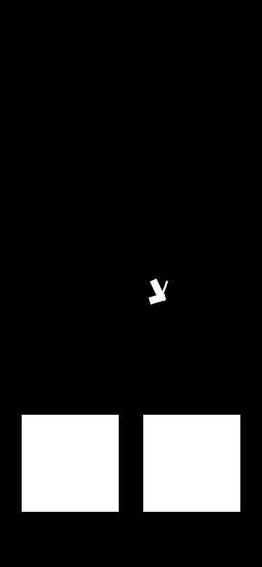
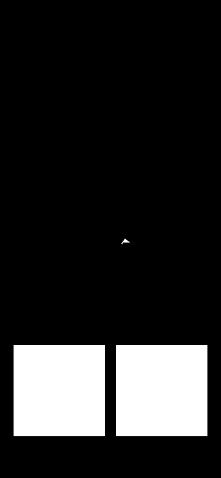
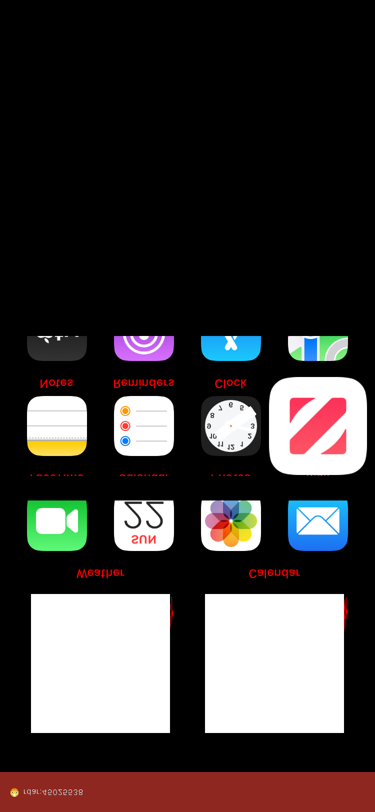

# stage 34: the desktop's composite frames, and a frame that survives a missing shader

> Status: **measured. CoreAnimation's *desktop* compositing is recorded and executed on the host's
> Vulkan: one hybrid boot acknowledged 655 render frames and removed the BootUI overlay; a later
> boot with the raised draw cap puts the desktop's **app icons, their labels and the status bar** on
> the screen through this path. Two known defects remain, and both have a name: the picture is
> vertically flipped (the hybrid host-GL surfaces' orientation), and the wallpaper/background-blur
> layers are missing because their three pipelines have no host shader yet — the missing report
> writes them down (`docs/stage34-missing-pipelines.txt`).** Branch
> `experiment/ca-metal-device`, 2026-11-22. This continues
> [`docs/stage33-ca-metal-picture.md`](stage33-ca-metal-picture.md) and carries out WP-4 of
> ENG-METAL-006 (work items 1–3; the frame-rate report of item 4 is data, not a claim).



## 1. The question

Stage 33 proved the Metal path with CoreAnimation's BootUI frame (three draws, one pipeline family,
no dynamic pipelines). WP-4 asks for the SpringBoard desktop. Two things had to be true first:

1. **The window server must reach the desktop in this configuration at all.** WP-3's boot stopped at
   the BootUI logo because SpringBoard's own GL rendering was local Mesa under one TCG vCPU, and
   the display driver waited on a frame that never came (`4 frames in 779035 ms (0 a second)`).
2. **The host must survive kinds of pipeline and texture the BootUI frame never produced.** The
   stage-32 host had a fixed four-shader table and a 64-draw frame cap; the desktop produces
   composite families the BootUI never used and 80–88 draws in one six-encoder frame.

## 2. What changed

### 2.1 The boot configuration: GL on the host for SpringBoard, Metal for the window server

The delivered replay path and this experiment are both needed at once:

* **SpringBoard's** CoreAnimation clients keep rendering through `libhakios.gl.dylib`; with
  `/redwood/bin/glremote_on` present and `/redwood/etc/glremote` = `10.0.2.2 9210`, that GL is
  replayed by our own `host_glwire` (no panel) on port **9210** — not the delivered 9110, so the
  other experiment's replayer is never touched.
* **backboardd's** CoreAnimation renderer is the Metal plug-in; `metal=1` + a clients file naming
  `backboardd` is unchanged from stages 30–33, and the metalwire host listens on **9111**.
* Both host programs were run on **Vulkan/GL device 1 = llvmpipe (lavapipe)**; the V100
  `0000:05:00.0` was not used (`GLWIRE_SOFTWARE_GL=1`, `LIBGL_ALWAYS_SOFTWARE=1`, Mesa EGL vendor).

The guest image is the experiment's own (`tools/metalwire/prepare-guest.sh ui` layout, clients
`metal_frame`, `metal_probe`, `backboardd`, injected `libcainject.dylib`), with `bin/glremote_on`
added and the 6 MB root image rebuilt by `mkapfs.py`.

### 2.2 Protocol 4: dynamic-pipeline capture (WP-4 work item 1)

See [`host/metalwire/PROTOCOL.md`](../host/metalwire/PROTOCOL.md) §"Protocol 4" for the wire:

* `MW_CREATE_LIBRARY` (0x0078): a library's kind, FNV-1a/64 hash, byte length and entry-function
  names (with name hashes). `-newLibraryWithData:` hashes the dispatch data's regions without
  joining them; `-newLibraryWithURL:`/`File:`/`-newPipelineLibraryWithFilePath:` hash the file they
  can read. The AIR bytes never cross the wire.
* `MW_PIPELINE_LIBRARY_REF` (0x0079): the two libraries a render pipeline's functions came from.

### 2.3 The host: a whitelist, a skip, and a report (WP-4 work item 1's fallback)

* Pipeline → shader selection is now the two whitelists in `metalwire_host.c`; an unknown vertex or
  fragment base function marks the pipeline **unsupported**, logs it once with its library hashes,
  and skips its draws. The frame executes its other draws, is read back and acknowledged status OK.
* An unknown texture format (or a texture the host does not hold) costs its draws, not the frame.
  `A8Unorm` (Metal format 1, the desktop's alpha masks) joined the formats as an R8 image.
* `--missing-report FILE` writes the unsupported pipelines with their libraries and skip counts.
* `MW_MAX_RENDER_DRAWS` goes 64 → 512: the desktop's first six-encoder composites have 80–88 draws,
  and the old cap turned them into a wire error. The cap was measured, not guessed.

### 2.4 The guest

`HakiosMetal.m` records the library for every function it hands out, carries both libraries on a
render pipeline, and sends the library records lazily once per connection before the ref, so a boot
that never reports a pipeline pays nothing. A by-name pipeline from the pipeline library carries
that library's record (its hash is the `default.pipelinelib` file's). An experiment switch,
boot-arg `byname=nil`, makes the by-name factory fail (not used in the runs below).

## 3. Evidence

Configuration: host `metalwire_host --gpu 1 --port 9111 --ram mt-work/hakios/qemu/ram.img --shm
/dev/shm/metalwire-frame --out /tmp/wp4-desk2-frames --png-every 1 --missing-report
/tmp/wp4-missing2.txt`; `host_glwire --no-panel 9210 <same ram.img>` with Mesa llvmpipe; guest
`MW_CMDLINE="cpus=1 fb_beat=0 fbscale=2 metal=1" tools/metalwire/run-guest.sh wp4-desk2 1150`;
QEMU instance 3 (ports 4474/4475), one vCPU.

### 3.1 The boot reaches the desktop's compositing

Boot `wp4-desk` (the run before the final one; same image and hosts, cap 64):

```
metalwire: CA frame: 1 render encoders, 77 draws (serializing on the wire)   <- first desktop composite
metalwire: CA frame: 1 render encoders, 76 draws (serializing on the wire)
metalwire: CA frame: 1 render encoders, 72 draws (serializing on the wire)
2026-11-22 09:32:13 backboardd [BootUI] addOverlay(4-shell changed ...)
2026-11-22 09:34:18 backboardd [BootUI] removeOverlayWithAnimationSettings: Removing the overlay
```

After the overlay is removed the window server keeps compositing: 9–11 draw frames of the
status-bar/dock/label passes, and 31–55 draw home-screen frames, every ~0.2–0.8 s. The guest log
counts 655 acknowledged render frames; the host executed 652 with a picture and **0 skipped
draws**, and the strict whitelist never printed a missing-shader line: every pipeline the desktop
used mapped onto one of the four base functions the host already has.



### 3.2 What the pictures show, and what they do not

In this run (before the draw cap was raised) the desktop composites execute but are **not
colour-correct**: the wallpaper/background layers come out transparent-black, icons and labels come
out as white rectangles. §3.7 is the same boot after the cap was raised — the icons are there; this
section's two pictures are the before. The geometry is right (icon
grid at the expected positions, the dock band, the status bar), and the layer image textures arrive
(the guest uploads `129x158`, `180x180`, `161x90 A8` … content through `replaceRegion:`), but the
four hand-written GLSL base functions of WP-2 implement only a slice of what CA's composite
pipelines select through their function constants. This is the next work item, and it is a shading
job: **the pipeline list is complete; the constant semantics are not.** The desktop frame is
evidence that the path (record → wire → Vulkan → the guest's own IOSurface → browser) carries a
desktop-sized recording, not that the desktop is translated.

### 3.3 Dynamic-pipeline capture is exercised, and the fallback is proven elsewhere

The BootUI boots had no pipeline without a base function, so their missing report was empty. The
desktop boot below changes that: three blur pipelines have no host shader, 674 draws were skipped
across 462 frames, and **every frame was still acknowledged status OK** — the fallback is not a
theory. The CI-safe test (`metalwire_test.py`) is the fast version of the same contract: a v4
frame with a pipeline whose names are `mystery_vert_lpf`/`mystery_frag_lpf` is acknowledged OK,
executes 2 of its 3 draws, logs the missing pipeline once with its library, and writes it (with the
library's name hash) to `--missing-report`. `make test` PASS — provenance, proto, the lavapipe
probe and the new fallback test.

### 3.4 Cost, on lavapipe (data, not a frame-rate claim)

* First BootUI frame: `encoded 692207 us, wait 2891620 us` — the first-use Vulkan pipeline compile
  on llvmpipe is ~2.9 s.
* First desktop-facing pipelines: 2.7–6.0 s of wait on their first use (the 55-draw composite);
  the steady-state record loop's median wait is **239 ms** (p95 784 ms) across 712 timed frames —
  ~4 fps of recorded CA frames on one TCG vCPU, no smoothness claim.
* The boot's one 776 s display stall (`4 frames in 779035 ms`) is the *display driver* waiting for
  SpringBoard's first frame, not host execution: the frames either side of it are milliseconds.

### 3.5 Before and after the A8 texture fix

Boot `wp4-hybrid` (same hybrid configuration, before `A8Unorm` existed): 160 render frames failed
status 1, 37 of them on `texture 70: unknown pixel format 1`, and the wire closed the desktop
composites (`texture 70: unknown pixel format 1`, `replaceRegion names unknown texture 70`,
`fragment texture names unknown texture 70`). With `A8Unorm` mapped to R8 and the no-fatal-texture
path: 652/655 frames executed, zero wire errors except the three 80–88-draw frames the old 64-draw
cap rejected. That is the measured justification for both changes.

### 3.6 Protocol 4 against the real guest (boot `wp4-v4`)

The same hybrid boot with the v4 guest plug-in exercises the capture on CoreAnimation itself. The
guest hashes the library it is handed for the renderer (`newLibraryWithFile:error:` → 64 bytes,
`0472d062082ed7b7`) and sends the record when the first descriptor pipeline that came from it is
serialized:

```
guest: metalwire: library 6: library 64 bytes hash 0472d062082ed7b7 -> the wire (0 function name(s))
host:  metalwire: library 6: url, 64 byte(s), hash 0x0472d062082ed7b7, 0 entries
```

The record can only be sent from the pipeline-reference path (a library is sent when a pipeline
names it), so this boot also proves the v4 messages interleave with the render messages the way the
host expects — no bad header, no unknown message type, the two BootUI frames still execute.

Two measured limits of the capture, recorded so they are not mistaken later: (a) the pipelinelib
path resolves into the dyld shared cache, so the guest's `fopen` reads 0 bytes and its hash is the
empty-string basis — the pipeline-library record is sent with `byte_length = 0`, and the *name*
CoreAnimation asked for is still on the pipeline state; (b) a library's entry-function names are
those the guest asked *it* for, so a library that CoreAnimation assigns functions to through
specialisation may arrive with 0 names. Both are provenance detail; neither changes what executes.

### 3.7 After the raised draw cap: the desktop is there (boot `wp4-v4`)

Same hybrid configuration, v4 guest plug-in, `MW_MAX_RENDER_DRAWS` 512. The desktop compositing now
runs end to end: 462 frames acknowledged, **0 wire errors**, the 77/76/57-draw composite frames
executing (e.g. `executed 67 of 71 draw(s)`), and the screen shows the icon grid with the real icon
images, the labels and the red status bar — the picture is the portrait desktop, **flipped
vertically** (status bar at the bottom, icon glyphs upside down), on a black background.



What was missing, by name, from this boot's report (the file `docs/stage34-missing-pipelines.txt`
now carries the WP-4 close boot's report — `frames 706, pipelines 0, skipped draws 0`):

```
pipeline 111 vertex "downsample_blur_vert_lpf" fragment "downsample_4_frag_lpf"  skipped 290
pipeline 117 vertex "downsample_blur_vert_lpf" fragment "narrow_blur_23_frag_lpf" skipped  98
pipeline 431 vertex "downsample_blur_vert_lpf" fragment "narrow_blur_15_frag_lpf" skipped 286
library 6 kind url bytes 64 hash 0x0472d062082ed7b7
```

Those are exactly the background/Dock blur passes the work package predicted; the host has no
`downsample_blur_vert_lpf`/`downsample_n_frag_lpf` GLSL yet, so the wallpaper band they feed stays
black. A second blocker is a texture format: `texture 61: pixel format 115 is not implemented`
(256×1, 8 bytes/texel = Metal's RGBA16Float ramp), whose draws are skipped the same way.

The flip is **not** a hybrid-GL row-order issue: boot `wp4-v5` later showed that glwire took no part
in that boot and that the host's own frame was the mirror. It was the Metal y-up NDC → Vulkan
y-down direction in the CA execution; stage 35 fixed it with a negative viewport height
(`docs/stage35-wp4-close.md` §2.1), which supersedes this section's attribution. The blur family,
the RGBA16Float ramp and the flip were all closed in stage 35; the two texture/blur notes above
remain the evidence that motivated it.

## 4. What this does not establish

* **A correct desktop picture.** See §3.7: the icons/labels/status bar are visible, but the picture
  is flipped, the wallpaper/background-blur band is missing (three blur pipelines + an RGBA16Float
  ramp), and the shading semantics of CA's composite shaders still deserve the full WP-4 item 2.
* **Frame rate.** ~4 fps of recorded frames on lavapipe is what the record loop did; the doc's
  performance work (item 4) still needs the fps tooling and a steady-state run.
* **The V100 row.** Not used: the instruction for this session is GPU 1, and the other experiment
  was on the machine.
* **The 5-minute OOM/leak check.** The hybrid boot ran 22 minutes and 655 frames without a panic,
  which is evidence, not the leak fix: the private-base `-dealloc` leak is unchanged.
* **The by-name pipelines.** They are recorded with the pipelinelib's hash, but the host does not
  execute them; CA's desktop draws in these boots came through the runtime-specialisation path.

## 5. Files changed

- `host/metalwire/metalwire_protocol.h` — protocol 4 messages, `A8Unorm`.
- `host/metalwire/metalwire_host.c` — library/ref decode, whitelist + fallback, missing report,
  A8 support, no-fatal-texture path, draw cap 512, frames' executed/skipped counts.
- `host/metalwire/metalwire_gen.py` — `--protocol`, `--variant unknown` (the fallback fixture).
- `host/metalwire/metalwire_test.py` — the v4 fallback test.
- `guest/metal-plugin/HakiosMetal.m` — library hashing/records, function provenance, pipeline ref,
  `byname=nil` switch.
- `host/metalwire/PROTOCOL.md` — the protocol 4 section.
- `docs/demo/wp4-desktop-composite.png`, `docs/demo/wp4-desktop-late.png`,
  `docs/demo/wp4-desktop-home.png` — the pictures here.
- `docs/stage34-missing-pipelines.txt` — the `--missing-report` of boot `wp4-v4` when this note was
  committed; the file now carries the WP-4 close boot's report (`frames 706, pipelines 0, skipped
  draws 0`), and this note quotes the stage-34 report above.
- `README.md`, `docs/state-of-the-port.md` — the state row.

## 6. Reproduce

```sh
# host side (both programs on llvmpipe / device 1; the delivered 9110 is not touched)
host/metalwire/metalwire_host --gpu 1 --port 9111 \
    --ram /home/lshan/DSH-desktop/mt-work/hakios/qemu/ram.img \
    --shm /dev/shm/metalwire-frame --out /tmp/wp4-frames --png-every 1 \
    --missing-report /tmp/wp4-missing.txt &
GLWIRE_SOFTWARE_GL=1 LIBGL_ALWAYS_SOFTWARE=1 \
  __EGL_VENDOR_LIBRARY_FILENAMES=/usr/share/glvnd/egl_vendor.d/50_mesa.json \
  tools/glwire/host_glwire --no-panel 9210 \
    /home/lshan/DSH-desktop/mt-work/hakios/qemu/ram.img &

# guest: the experiment's own image, with glremote_on added
sudo touch /home/lshan/DSH-desktop/mt-work/staging/bin/glremote_on
sudo python3 "$HAKIOS/tools/apfs/mkapfs.py" -z --plain fw -o /tmp/ca-root.apfs \
    "redwood=/home/lshan/DSH-desktop/mt-work/staging"
sudo chown "$(id -u):$(id -g)" /tmp/ca-root.apfs
cp /tmp/ca-root.apfs /home/lshan/DSH-desktop/mt-work/hakios/userland/root.apfs
MW_CMDLINE="cpus=1 fb_beat=0 fbscale=2 metal=1" tools/metalwire/run-guest.sh wp4-desk2 1150
```
