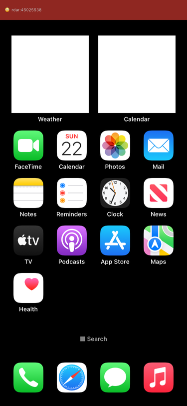

# stage 35: WP-4 closes — an upright desktop, the blur family, and the material underneath

> Status: **measured. The three implementation items of WP-4 are on the branch and each is
> answered by a boot: the frame is upright, the background/Dock blur family exists on the host, and
> Metal's RGBA16Float (format 115) is a real Vulkan image. The shading defects that the close
> surfaced (D3 Dock white band, D4 red labels, D5 Search capsule) are fixed on the host, and the
> record carries a frame-rate baseline for lavapipe and the V100. The picture is still not a finished
> desktop: the wallpaper layer is black (D1), two widgets are white placeholders (D2), the status
> bar carries the image's debug banner (D7), and every second presented frame loses the
> status-bar/Dock/Search layers (D8 — a two-buffer defect that predates this work).** Branch
> `experiment/ca-metal-device`, 2026-11-23. This closes WP-4 of ENG-METAL-006 and continues
> [`docs/stage34-wp4-desktop.md`](stage34-wp4-desktop.md).



## 1. The question

Stage 34 put the window server's desktop composites on the host's Vulkan and named three gaps:
the picture was **vertically flipped**; the **background/Dock blur family** and the
**RGBA16Float ramp** had no host implementation; and the composite shaders' constant semantics were
implemented only for a slice. WP-4 asks for the desktop, and stage 34's own "what this does not
establish" made the close concrete:

1. an **upright** desktop, with the screen and the host's frame holding the same rows;
2. the **blur pipelines** named by the missing report (`downsample_blur_vert_lpf` with
   `downsample_4`/`narrow_blur_23`/`narrow_blur_15`, and the siblings a live backdrop asks for),
   and format 115 as a texture the host can create, upload, sample and read back;
3. a **frame-rate baseline** measured from the same recordings, so a later V100 run has something
   to compare against.

This record answers each with a boot, corrects stage 34's attribution of the flip, and lists what
is still open by name.

## 2. What changed

### 2.1 WP-4 item 1.1: the frame is upright

The first attempt assumed the hybrid host-GL surfaces' row order and added an experiment switch,
`GLWIRE_SURFACE_FLIP`, to `host_glwire`'s by-reference write-back (`44c1b25`, with an offline
row-order test; default behaviour unchanged). Boot `wp4-v5` disproved that attribution: glwire took
no part in it (0 clients, no frames), and the screen matched the host's mirrored frame at
0.64/255 while the same frame turned right-way-up differed by 108.77/255.

The real cause is in the CA→Vulkan execution (`8327b39`): Metal's NDC has y up and CA's mvp puts a
layer's top at NDC y=+1, while a Vulkan viewport maps NDC y down. The host passed CA's viewport
through with a positive height, so every CA draw landed mirrored. The fix is one point in
`mw_run_render_frame()`:

```c
vp.y = ca_y + ca_height;
vp.height = -ca_height;      /* Metal y-up -> Vulkan y-down; the scissor is unchanged */
```

Negative viewport height is core Vulkan 1.1 (promoted from `VK_KHR_maintenance1`), and this render
path already requires Vulkan 1.3 dynamic rendering, so lavapipe and the V100 driver both take it.
The alternative — negating `gl_Position.y` in every vertex shader — would have made four shader
families and every future shader carry the correction; flipping rows in the IOSurface write-back
would have pointed the present read-back, PPM/PNG, SHM and `--byte-check` the other way. With this
fix all consumers keep the same framebuffer row order.

The regression (`--orientation`) uses a 64×64 source whose every row has its own colour: frame 1 is
a 1:1 copy through CA's mvp, frame 2 adds a framebuffer-fetch draw that blends 50% over the
destination (a wrong fetch origin reads the mirrored row). It asserts, with 0 tolerance, that the
seed and the read-back hold source row *y* at output row *y*, that PPM and PNG are the same picture,
and that the SHM picture and the by-reference IOSurface segment (a fake `--ram` file the target
names) hold the same last frame. The same fixture against a host built without the negative height
comes out exactly flipped, so the assertion bites.

### 2.2 WP-4 item 1.2: the background/Dock blur family

Stage 34's report named three pipelines; boot `wp4-v6` showed the real family is larger. The vertex
function is shared, and eight fragment kernels exist in the recorded UI:

| base function | pipeline code | what the recorded draw does |
|---|---|---|
| `downsample_blur_vert_lpf` | — | CA's transform with the texture matrix; serves all eight |
| `downsample_4_frag_lpf` | `Tds4` | 4×4 box average, 16 `texelFetch` taps |
| `downsample_8_frag_lpf` | `Tds8` | 8×8 box average, 64 taps |
| `narrow_blur_23_frag_lpf` | `Tn23` | one-pass separable Gaussian, 23 taps/axis |
| `narrow_blur_19_frag_lpf` | `Tn19` | 19 taps/axis |
| `narrow_blur_15_frag_lpf` | `Tn15` | 15 taps/axis |
| `narrow_blur_11_frag_lpf` | `Tn11` | 11 taps/axis |
| `narrow_blur_7_frag_lpf` | `Tnb7` | 7 taps/axis |
| `narrow_blur_27_frag_lpf` | `Tn27` | 27 taps/axis |

All nine files are hand-written Vulkan GLSL (`host/metalwire/shaders/`); no Apple byte was copied
or disassembled, and every inferred constant is marked `[INFERRED]` in the file header with the
boot evidence that fixes it. The kernels come from the function names and the recorded one-pass
chains; the weights are Pascal's triangle / the standard integer Gaussian approximation, because
the exact kernel is not in the record. `4360d2a` added the first four base functions and their
fixture; `214fab4` added the five that boot `wp4-v6`'s backdrop asked for. The embedded module
table grew from four to thirteen.

Boot `wp4-v6`'s Control Center attempt is also the measurement that motivated the second half:
five kernels were missing, `--missing-report` counted 1,916 skipped draws, the backdrop target held
only its clear colour, and 609 of 640 frames after the gesture were more than 98% black. After
`214fab4` the report is `0 pipelines / 0 skipped draws` in every later boot — the protocol-4
contract holds: an unknown pipeline costs its draws, never the frame.

### 2.3 WP-4 item 1.3: RGBA16Float, Metal format 115

Boot `wp4-v4` logged `texture 61: pixel format 115 is not implemented` and lost CoreAnimation's
256×1 colour ramp the same way it loses a missing shader. `73e6520` maps format 115 to
`VK_FORMAT_R16G16B16A16_SFLOAT` (8 bytes a texel) through the same create / buffer→texture blit /
`replaceRegion:` / read-back path as the 4-byte formats:

* `metalwire_protocol.h`: `MW_FORMAT_RGBA16_FLOAT = 115`;
* `mw_vk_format`/`mw_format_bytes` and a known-format gate for texture creation;
* the present-path CRC hashes `width × bytes-a-texel` rows (it was hardcoded `width × 4`, which
  would have compared half the ramp), and the IOSurface round trip uses the format's texel size;
* PPM/PNG/SHM conversion decodes binary16 (clamp to [0,1], round to nearest, NaN/negative → 0);
  R8/A8 convert as grey instead of reading four bytes a texel;
* the unknown-format fallback is unchanged and pinned: format 999 still logs `not implemented` and
  its frame is still acknowledged status OK.

The regression presents a 256×1 RGBA16Float ramp (2,048 bytes) and checks the ack CRC over the raw
half-float bytes, `--byte-check` read-back, and the 8-bit PPM/PNG ramp. The binary16 decoder was
compared bit-exactly against Python's `struct` for all 65,536 half patterns: 0 mismatches.

### 2.4 The shading defects the close surfaced (D3/D4/D5)

The desktop's remaining colour defects were not blur or format problems. Each was fixed on the
host, with a fixture and a boot measurement:

* **D4 — every icon label red** (`7c33925`): an A8 glyph mask was expanded as `(R,R,R,R)`; the
  mask's coverage now modulates a white colour (`ONE,ONE,ONE,R`), so RGB is coverage and alpha is
  the mask. Boot `wp4-v8`'s label rows no longer contain red.
* **D3/D5 — the Dock's white band and the Search capsule** (`5e1ba3d`, `b1add02`, `b232e33`):
  - `5e1ba3d` made a frame's passes render into their own targets (a frame's second pass now
    samples the texture the first pass rendered; the `--chain` fixture).
  - `b1add02` added the off-by-default per-draw dump (`MW_DUMP_DRAWS=1`: pipeline, vertex colour,
    the first 16 bytes of the fragment uniform, bbox, texture, fetch) that made the next step
    possible without guessing.
  - `b232e33` fixed the last cause: the `Tmua` material pipeline was specialised to
    `texture 0` by the host's whitelist, so the fixed fragment shader used the white vertex colour
    and fetch's source-over, producing an opaque white band. `mw_pipeline_has_texture` now knows
    `Tmua` (the multiply-alpha material binds a support texture and fetches its target), so the
    pipeline samples texture 3 × vertex colour with fetch source-over. A `Tmua` draw without a
    bound texture keeps the dummy view and its old behaviour; clear and other fragment semantics
    were not touched.
  - The evidence is the draw record of boot `wp4-v12`: lines 100/103/310/313 of
    `/tmp/wp4v12-evidence/d3d5-draws.txt` — the Dock band `(20,1416,710,188)` and the Search
    `(297,1326,156,60)` are drawn by the same pipeline `PBGRABsov_TmuaXfcn_IsrcCcl_Isup` with
    `vertex_color=1,1,1,1`, `fetch=1`, `fragment texture3=112`, and a near-zero uniform16 — while
    the `wp4-v12` host log (line 269) says that pipeline is `texture 0, fetch 1`. Boot `wp4-v13` then says
    `topology 3, texture 1, fetch 1`, and the two regions' pure-white pixel counts fall from 68.3%
    and 71.0% to 9.9% (icon glyphs only) and 0%.

### 2.5 WP-4 item 4: the frame-rate tool and its baselines

`721d4e1` adds `tools/metalwire/fps-measure.py`: a frame directory (PPM mtimes), the host log and
the serial log become a JSON and a markdown report. It records the recipe (tool commit, boot
commit, host md5, image md5s), the windows, and the p50/p95 definitions the earlier reports used;
`draws/frame` comes from the host's `render frame N: executed X of Y draw(s)` lines. The measured
numbers are in §3.6 — recorded-frame rate, not a smoothness claim.

### 2.6 The commits of this record

| commit | what it establishes |
|---|---|
| `73e6520` | format 115 is a Vulkan image (WP-4 1.3) |
| `4360d2a` | four blur base functions + fixture (WP-4 1.2, first half) |
| `44c1b25` | `GLWIRE_SURFACE_FLIP`, the experiment switch (WP-4 1.1, hypothesis) |
| `8327b39` | negative viewport height: the frame is upright (WP-4 1.1, fix) |
| `214fab4` | five more blur base functions; the family is complete (WP-4 1.2) |
| `721d4e1` | `fps-measure.py` (WP-4 item 4) |
| `7c33925` | A8 masks modulate colour (D4); D3/D5 evidence |
| `5e1ba3d` | per-pass render targets (D3/D5 chain) |
| `b1add02` | per-draw diagnostic dump (off by default) |
| `b232e33` | `Tmua` samples its support texture (D3/D5) |

## 3. Evidence

### 3.1 The closing boot (lavapipe, `wp4-v13`)

Configuration: the tree at `b232e33`, rebuilt as a 13-module binary via `git archive` (the
working tree was not used). Guest: the contributor's own image, clients
`metal_frame`/`metal_probe`/`backboardd`, injected `libcainject.dylib`; the two host programs on
lavapipe (the V100 was left to the other experiment):

```sh
VK_ICD_FILENAMES=/usr/share/vulkan/icd.d/lvp_icd.json \
  MW_DUMP_DRAWS=1 \
  host/metalwire/metalwire_host --gpu 0 --port 9111 \
    --ram .../mt-work/hakios/qemu/ram.img --shm /dev/shm/metalwire-frame \
    --out /tmp/wp4v13-frames --png-every 1 --verbose \
    --missing-report /tmp/wp4v13-missing.txt
GLWIRE_SOFTWARE_GL=1 LIBGL_ALWAYS_SOFTWARE=1 \
  __EGL_VENDOR_LIBRARY_FILENAMES=/usr/share/glvnd/egl_vendor.d/50_mesa.json \
  tools/glwire/host_glwire --no-panel 9210 .../mt-work/hakios/qemu/ram.img
MW_CMDLINE="cpus=1 fb_beat=0 fbscale=2 metal=1" \
  tools/metalwire/run-guest.sh wp4-v13 1800
```

Boot `wp4-v13`, 2026-11-23 06:14:31 → 06:35:37 (1,266 s; the desktop appeared at 06:31 and the run
was stopped with SIGTERM once the decisive evidence was in — it did not run the full 1,800 s):

* **706 frames acknowledged**, **7,363 executed draws**, wire error **0**, `pixel format 115 is not
  implemented` **0**;
* `--missing-report`: `# frames 706, pipelines 0, skipped draws 0` — every pipeline the desktop
  used is a host base function, and no draw was skipped;
* the host executed each frame with `status 0 (executed on Vulkan)` (706 such lines) and wrote
  750×1624 pictures for the present path;
* `PBGRABsov_TmuaXfcn_IsrcCcl_Isup` is `topology 3, texture 1, fetch 1`; the sibling
  `TmuaXfc_Isrc_Isqr` is also `texture 1, fetch 1`;
* the 256×1 format-115 ramps are textures: `texture 61: 256x1 format 115, 2048 bytes` and
  `texture 127: 256x1 format 115, 2048 bytes`.

### 3.2 The picture

Committed: [`docs/demo/wp4-desktop-upright.png`](demo/wp4-desktop-upright.png) — a 375×812
LANCZOS downscale of the good frame (the downscale is byte-identical to the run's own thumbnail;
sha256 below). It is the project's own pixels; no Apple asset.

| capture | size | sha256 |
|---|---|---|
| `wp4-desktop-upright.png` (committed) | 375×812 | `1de573dfc5e0206af73ab51ceb04cc8c7ed2ebaecb59febf9d7c9647990d82b2` |
| the good frame (run artifact) | 750×1624 | `ee3d98bf03c606c251e729ffdec2e61b9befe56e204e39533c3ca7dff9202ae2` |
| the black half of the alternation (run artifact) | 750×1624 | `14bdd86d4172b20c8a432696fcf40bb24f821aa9f98f588826a3f672f4b68fd0` |
| BootUI (run artifact) | 750×1624 | `2edab816a6a51bd9fc5762273681b5b03165c39e4ab4b1a56420aaf2995e6b1a` |
| the boot's stage-2 capture (a black half) | 750×1624 | `3dfefe19ba936227a3c62273a898a4cab85db2176a45651e9039f21645da2700` |
| the boot's stage-3 capture (a black half) | 750×1624 | `3e084616a79e075474f9cd2adf62403d4c4972cd5639986fcf6bdbcb454d33bf` |

What the good frame shows: the status-bar band at rows 0–79 with its red debug banner, real app
icons with their real images, white labels, a black wallpaper, the Search row, and the Dock with
four icons. The Weather/Calendar cells are white placeholders (D2) and the wallpaper is black (D1);
those are guest/image-side, not host shading.

The upright evidence is the screen comparison: the QEMU screendump and the nearest host frame hold
the same rows at mean|diff| **8.58/255**; compared with the frame flipped, **110.39/255**. The
BootUI frame is upright too (black fraction 0.9893, white 0.0101 with the Apple leaf on top). The
boot before the NDC fix reported 0.64 vs 108.77 with the mirror in the host's own frame; the two
numbers together show the fix is in the frame, not in the capture.

D3/D5 pixel table (fixed regions, the good frame vs boot `t13`'s steady frame):

| region | statistic | `wp4-v13` good | `t13` (before `b232e33`) |
|---|---|---|---|
| Dock `(20,1416,710,188)`, 133,480 px | pure white | 13,199 (9.9%) — icon glyph rows only | 91,143 (68.3%) — the whole band |
| | mean / std | 60.7, 76.2, 62.0 / 97.8 | 210.7, 226.3, 212.0 / 73.4 |
| Search `(297,1326,156,60)`, 9,360 px | pure white | 0 | 6,650 (71.0%) |
| | mean / std | 13.6, 13.6, 13.6 / 42.0 | 194.8, 194.8, 194.8 / 101.1 |

The Dock's white now sits only in y1450–1570 (the icon glyphs); the band's top and bottom padding
have 0 white pixels. The Search capsule is gone: a small grey square and the word "Search" float on
the black wallpaper. This is the `Tmua` material sampling its support texture, not a white fill.

### 3.3 What the blur family executes, and what is fixture-only

The unit fixture (`--blur` in `host/metalwire/metalwire_test.py`) creates all eight backdrop
pipelines, draws all eight in one frame into a 4×2 mosaic of its own target, executes 8 of 8
draws, reports `frames 2, pipelines 0, skipped draws 0`, and matches every tile against the same
box/binomial kernel computed in Python (max diff 1/255, allowed 2). That is the implementation
evidence for all eight kernels.

Real-boot coverage is smaller and is stated as such: `Tds4` and `Tn23` execute in the steady
desktop (the two pipelines stage 34's report named, and the ones the wallpaper band needs);
`Tn19` executed in boot `wp4-v8` during a backdrop transition; `Tds8`, `Tn27`, `Tn11`, `Tnb7` and
`Tn15` have **no boot execution yet**. Three later boots (`wp4-v8`/`wp4-v9`, `wp4-v9b`,
`wp4-v10`) made repeated attempts to open Control Center/Spotlight (burst, slow drag, deep drag,
after a wake) and never completed the transition — the HOME screen's layout moves, the UI does not
appear — so the guest never asked for those pipelines. This is a guest/interaction boundary, not a
host skip: `--missing-report` is `0 pipelines, 0 skipped draws` in every one of those boots because
every base function now exists.

### 3.4 The frame-rate baselines

Measured with `tools/metalwire/fps-measure.py` from PPM mtimes; recorded-frame rate, not a
smoothness claim. Both baselines are at commit `8327b39` (the frame-rate work was measured before
the later D3/D4/D5 commits); the closing boot `wp4-v13` did not run the full window.

| window | lavapipe `wp4-v6` | V100 `wp4-v7-v100` |
|---|---|---|
| steady desktop | 547 frames / 299.7 s = **1.82 fps** | 2,653 frames / 1,354.8 s = **1.96 fps** |
| | p50 0.229 s, p95 0.652 s | p50 0.242 s, p95 0.638 s |
| last 300 s | — | 586 frames / 299.9 s = **1.95 fps** (p50 0.235, p95 0.574) |
| last 60 frames | 60 / 29.1 s = 2.03 fps | 60 frames = 1.40 fps (one 13.39 s stall) |
| draws/frame | 11.44 | — |

The lavapipe run: 2,037 recorded frames, 1,916 at the panel's 750×1624, 2,322.175 s overall,
0.877 fps; the post-trigger window is 1.40 fps. The V100 run: 2,729 frames acknowledged, 27,058
executed draws, `0 pipelines / 0 skipped draws`, 60/60 frames status 0 with `executed == total`,
wire error 0, format 115 0; screen and host frame same-direction 0.88/255 vs 126.77 flipped. The
V100 is ~7% faster in the steady window; the bottleneck remains the guest's single TCG vCPU
recording and the wire, not host rasterisation. On the V100, `Tds4` and `Tn23` were executed;
`Tn15` was never requested — deny it steady-desktop coverage and defer it to the backdrop path.

### 3.5 Hashes of the inputs

| item | value |
|---|---|
| commit (the boot's tree) | `b232e33a0ed2a747fb67af177d982b427bf248b2` |
| `metalwire_host` (rebuilt with `git archive b232e33`) | `98359e0acaa95cf912c52c2c6a91c89a` |
| `host_glwire` | `5b28249a37cb11207f3ab160bcf4ac23` |
| `system.apfs` | `49ae3cf4fd53334b475a921eb9915008` |
| `root.apfs` | `964abbea112a85e625ee7f6f817d0768` (baseline; no gesture scripts) |
| `libcainject.dylib` | `aa123ccdd6ee4661fa335ac91311bbb1` |
| `HakiosMetal` | `1152ababffb940c3575bd48e62b295e4` |
| clients file | 35 B: `metal_frame\nmetal_probe\nbackboardd\n` |
| vars 0xFF source | sha256 `dd30d9e07e89c1749cd420e998190ab9e31d4b43d27b5862887320ba2a2b8b0f` |

The guest plug-in and the root image are the baseline from stage 34; **no `guest/` file changed in
this record** — every fix is in `host/metalwire/` or `tools/metalwire/`.

### 3.6 Repository gates

```
$ make test                 # test-open + the lavapipe probe
provenance-check: clean (478 tracked files)
== protocol (proto/ submodule) ==
  proto: pass
test-open: provenance clean, 1 component suite(s) run
[ok] device: llvmpipe (LLVM 20.1.2, 256 bits)
[ok] create buffer 1 MiB
[ok] write 1 MiB, readback identical
[ok] blit copy 512 KiB ... device checksum ok
[ok] blit fill 0..999996 (device checksum ok)
[ok] 40 command buffers in order
[ok] fence signal/wait ordering
[ok] screenshot build/screenshot.png (320x200, 22 unique colours, PNG verified, ...)
```

The translator's suite is **12 PASS** at this tree: frames, CSV, SHM, files, v4 fallback, format
115, blur, labels, draw-dump, material, chain, orientation. The three WP-4 items and the D3/D4/D5
fixes each own one of those checks.

`make style` is **not green on this branch and was not before this record**: `check-spdx` reports
59 of 105 root-tree files without an SPDX header (legacy `tools/glwire/`, `guest/` and
`docs/charts/` sources; the `proto` and `host/vkbridge` trees are clean), and `check-links` reports
54 pre-existing references over archived `docs/gpu-acceleration-*` and other notes. This record
adds no new failing reference (54 problems before and after; the reference count grew from 319 to
326). The contributor gate the CI workflow runs (`.github/workflows/linux.yml`) is
`make test-open`, which this tree passes; `make test` (the same plus the lavapipe probe) is green
too. The docs changes are text and one PNG under `docs/demo/`, which the provenance gate allows by
design.

## 4. What this does not establish

* **A finished, "100% correct" desktop.** Three defects are open, all named and none of them
  introduced by this work:
  - **D8 — the two presentation buffers are not equivalent.** Every second frame loses the
    status-bar/Dock/Search layers: 250 consecutive frames are 125 good / 125 black in strict
    alternation, and the host's render target alternates between textures 52 and 55 with different
    non-zero byte counts (`t17`: 2,709,447 vs 2,361,858, difference 347,589 ≈ the three layers).
    The same alternation exists in boots `t13` and `t19` (different binaries), so it predates the
    `Tmua` fix; before it, both buffers drew the Dock white, and now the good buffer shows the
    material while the other lacks the three layers. Screenshots must take the good frame; the
    panel flashes at the alternation rate. This is the next task.
  - **D1/D2 — wallpaper and widgets.** The wallpaper layer arrives as black and the
    Weather/Calendar cells are white placeholders; these are guest/image-side, outside this
    record's host scope.
  - **D7 — the status bar's `rdar:45025538` banner** is the experiment image's debug overlay.
* **Boot coverage of five blur kernels.** `Tds8`, `Tn27`, `Tn11`, `Tnb7`, `Tn15` are implemented
  and fixture-verified, but Control Center/Spotlight could not be opened in three boots, so the
  guest never requested them. Their visual correctness in a live backdrop remains to be measured.
* **A visible blur band in this screenshot.** With D1's wallpaper still black there is nothing for
  the blur to show; the Dock/Search now display the material's support texture, not a blur of a
  wallpaper.
* **The final commit on the V100.** The V100 regression in §3.4 ran `8327b39`; the commits that
  followed (`214fab4` … `b232e33`) have not been re-run there. The `0000:05:00.0` card was in use by
  the other experiment, and the final V100 row is the follow-up.
* **A guest-side per-frame checksum.** The CA render path's `ack.crc_ok` is set to 1 by the host
  (the guest did not hash a picture it did not draw), so 60/60 means status 0 and
  `executed == total`, not an end-to-end comparison.
* **The by-name pipelines** are recorded but not executed; CA's desktop draws came through the
  runtime-specialisation path.

## 5. Files changed in this record

- `docs/stage35-wp4-close.md` — this note.
- `docs/demo/wp4-desktop-upright.png` — the capture above.
- `docs/demo/NOTES.md` — its provenance block.
- `docs/stage34-missing-pipelines.txt` — replaced with the closing boot's report
  (`frames 706, pipelines 0, skipped draws 0`); the stage-34 boot's report is quoted in
  `docs/stage34-wp4-desktop.md`.
- `docs/stage34-wp4-desktop.md` — §3.7's flip attribution corrected (it was the Metal→Vulkan NDC
  direction, not glwire's row order).
- `docs/state-of-the-port.md`, `README.md` — the Metal state row and the milestone/index entries.

The implementation commits listed in §2.6 changed `host/metalwire/` (shaders, `metalwire_host.c`,
`metalwire_protocol.h`, `metalwire_gen.py`, `metalwire_test.py`, the Makefile and the READMEs),
`tools/glwire/` (the experiment switch and its offline test) and `tools/metalwire/fps-measure.py`.
No `guest/` file changed.

## 6. Reproduce

```sh
# the translator's own suite (no guest, no Apple file)
cd host/metalwire && make clean && make test

# the closing boot: two host programs on lavapipe, the V100 left alone
VK_ICD_FILENAMES=/usr/share/vulkan/icd.d/lvp_icd.json \
  host/metalwire/metalwire_host --gpu 0 --port 9111 \
    --ram .../mt-work/hakios/qemu/ram.img --shm /dev/shm/metalwire-frame \
    --out /tmp/wp4v13-frames --png-every 1 --verbose --missing-report /tmp/wp4v13-missing.txt &
GLWIRE_SOFTWARE_GL=1 LIBGL_ALWAYS_SOFTWARE=1 \
  __EGL_VENDOR_LIBRARY_FILENAMES=/usr/share/glvnd/egl_vendor.d/50_mesa.json \
  tools/glwire/host_glwire --no-panel 9210 .../mt-work/hakios/qemu/ram.img &
MW_CMDLINE="cpus=1 fb_beat=0 fbscale=2 metal=1" tools/metalwire/run-guest.sh wp4-v13 1800

# the frame-rate report from that boot's output
tools/metalwire/fps-measure.py --frames /tmp/wp4v13-frames \
  --host-log /tmp/wp4v13-metalwire-host.log \
  --trigger <the desktop frame's timestamp> --tag wp4-v13 \
  --boot-commit b232e33a0ed2a747fb67af177d982b427bf248b2 \
  --host-md5 98359e0acaa95cf912c52c2c6a91c89a \
  --out-json /tmp/wp4v13-fps.json --out-markdown /tmp/wp4v13-fps.md
```
