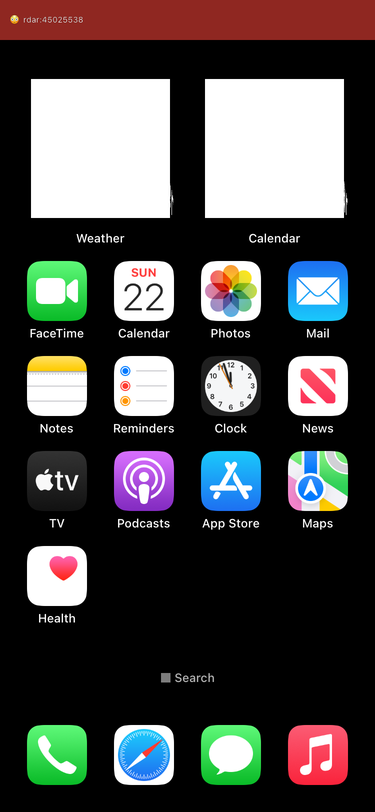

# stage 39: the two display buffers become equivalent (D8 fixed)

> Status: **measured and fixed. D8 — the panel alternating between a complete desktop and a frame
> whose status bar, Dock icons and Search text are missing — was CoreAnimation's two display
> surfaces diverging, with the host's new per-frame copy pushing the poorer picture into the richer
> surface. Three commits make the copy content-aware and add Metal's RG8Unorm (format 30) support.
> The final boots — lavapipe `wp4-v14b` and V100 `wp4-v15` — hold the complete picture in **both**
> surfaces: 0 black frames, no 2-frame alternation, `0 pipelines / 0 skipped draws`, wire error 0,
> format 30 and 115 0, and recorded-frame rates of **2.83 fps** (lavapipe) and **2.55 fps** (V100).**
> Branch `experiment/ca-metal-device`, 2026-11-23. This continues
> [`docs/stage35-wp4-close.md`](stage35-wp4-close.md), which recorded D8 as the open defect.



## 1. The question

Stage 35 closed WP-4 with an upright, complete-looking desktop, but every second presented frame
lost its status bar, Dock icons and Search text. The alternation was strict — 125 good / 125 black
over 250 consecutive frames — and the host rendered into two textures, 52 and 55, whose read-backs
differed by a constant 347,589 non-zero bytes, almost exactly the area of those three layers. The
same alternation existed in boots `t13` and `t19` with different binaries, so it predated the
`Tmua` material fix; screenshotting the good frame hid it, the panel did not.

The guest's own behaviour explains why an easy answer ("just copy each frame into both surfaces")
is not enough. CoreAnimation presents through two display surfaces and does not draw the same layer
subset into both: frames 4–13 of boot `wp4-v13` redraw both surfaces in full but with different draw
sets (frame 9: 64 draws → 2,292,196 non-zero bytes; frame 12: 80 draws → 2,596,221), and every
later frame repaints only the clock with load action `LOAD`. A surface whose own full redraw
happened to miss a layer therefore stays wrong forever, while the other surface gets it.

## 2. What changed

### 2.1 The first fix: converge the two surfaces (`13549ea`)

An offline fixture first ruled out the obvious suspect: a frame that preserves its target (`LOAD`
or `DONT_CARE`) keeps the previous content on lavapipe (max diff 0), so the host was not dropping
cross-frame content. What was missing is that CA never renders the same subset into both surfaces
and never copies one surface into the other.

The fix copies the previous frame's picture in when a frame's first draw preserves its target
(`LOAD`/`DONT_CARE`) and that target is a different surface of the same size and format as the
previous frame's. A `CLEAR` first draw discards the content by definition and skips the copy. The
copy is one `vkCmdCopyImage` with the matching `TRANSFER_SRC`/`TRANSFER_DST` barriers; the target is
returned to `COLOR_ATTACHMENT_OPTIMAL` before the draws.

The per-draw dump grew three fields so the next boot can see the mechanism directly:
`texture=<id> fetch=<0|1> target=<id> load=<0|1|2> store=<0|1>`.

### 2.2 The copy needs a richness rule (`fb1f0b3`)

Boot `wp4-v14` (t22) showed the copy alone is not sufficient: the alternation disappeared (the last
250 pairs of textures 52/55 differed by max 36 bytes, last 1), but the **Dock and Search were gone
from both buffers**. The draw dump and the read-backs pin the sequence down:

* the Dock/Search material draws only appear in the early full frames — Dock at draws line 103
  (frame 6, `target=55 load=1`) and line 308 (frame 9, `target=52 load=1`), Search at lines
  100/305;
* the surfaces peak at **2,779,312** non-zero bytes (frame 7, texture 55) and **2,512,062** (frame
  10, texture 52);
* frame 11 (55) settles at 2,385,130 and frame 12 (52) **drops** from 2,512,062 to 2,385,130, frame
  13 (55) to 2,385,129 — the clock-only frames copied their poorer picture into the richer surface,
  and the missing layers then travelled from one buffer to the other.

The fix records each surface's last read-back non-zero count (`mw_image.content_nonzero`) and runs
the double-buffer copy only when `previous->content_nonzero >= target->content_nonzero`. A
clock-only frame therefore leaves a richer destination untouched, while a richer source still fills
a surface that never received the layers. After a copy the target inherits the source's count, so
the next comparison starts from the new content. The `--dual-buffer` fixture was extended to the
real sequence (full layers into 90; a poor quarter into 91; clock-only frames 90/91/90/90 with
`LOAD`, one `DONT_CARE`): without the guard, frame 2 drops the surface to 800 non-zero bytes with
the layers black — exactly wp4-v14's missing Dock/Search; with the guard all six frames match the
full static layers plus the clock (11,648 non-zero bytes each).

### 2.3 The other wire error: RG8Unorm, format 30 (`85beab5`)

Boot `wp4-v14` also ended with `wire error 1`: `texture 146: pixel format 30 is not implemented; its
draws are skipped`. The texture is CoreAnimation's two-channel support texture (23×23×1) for the
`PBGRABsov_TmuaXfc_Ixrg_Isrg` material; its `replaceRegion:` was dropped and the material draw that
samples it was skipped. The format is `MTLPixelFormatRG8Unorm` — the iPhoneOS 16.5 SDK's
`MTLPixelFormat.h` has `MTLPixelFormatRG8Unorm = 30` between `R16Float = 25` and
`RG8Unorm_sRGB = 31`; two 8-bit unsigned normalized channels, 2 bytes a texel, alpha 1.0. The
guest's own size agrees: 23×23×1, and the wire's 1,472-byte `replaceRegion:` payload is 23×32
texels × 2 bytes.

The host now maps 30 to `VK_FORMAT_R8G8_UNORM`; `mw_format_bytes()` returns 2 so texture creation,
sparse stride, `replaceRegion:` stride, staging row length and read-back size all follow; PPM/PNG
convert it to `(R,G,0)` and SHM to `(0,G,R,255)`. The unknown-format fallback is unchanged. The
`--rg8` fixture uploads a 256×2 RG8 ramp, checks the ack CRC over the raw 2-byte texels (so a wrong
stride cannot pass), samples it through `PBGRA_TimgXfc_Isrc` into a BGRA target, and requires both
PPMs to be exactly `(R,G,0)`.

### 2.4 The commits of this record

| commit | what it establishes |
|---|---|
| `13549ea` | converge the two display surfaces with a per-frame copy (D8, first half) |
| `fb1f0b3` | the copy only pushes content that is at least as rich; Dock/Search stay (D8, second half) |
| `85beab5` | `MTLPixelFormatRG8Unorm` (30) is a real Vulkan image (the other wp4-v14 wire error) |

## 3. Evidence

### 3.1 The final lavapipe boot (`wp4-v14b`, t27)

The tree at `85beab5`, rebuilt with `git archive` (13 modules): `metalwire_host` md5
`3830787b58460cb3110089f8e946a886`. Guest: the contributor's own image, clients
`metal_frame`/`metal_probe`/`backboardd`, injected `libcainject.dylib`; both host programs on
lavapipe (the V100 was left alone):

```sh
VK_ICD_FILENAMES=/usr/share/vulkan/icd.d/lvp_icd.json \
  MW_DUMP_DRAWS=1 host/metalwire/metalwire_host --gpu 0 --port 9111 \
    --ram .../mt-work/hakios/qemu/ram.img --shm /dev/shm/metalwire-frame \
    --out /tmp/wp4v14b-frames --png-every 1 --verbose \
    --missing-report /tmp/wp4v14b-missing.txt
GLWIRE_SOFTWARE_GL=1 LIBGL_ALWAYS_SOFTWARE=1 \
  __EGL_VENDOR_LIBRARY_FILENAMES=/usr/share/glvnd/egl_vendor.d/50_mesa.json \
  tools/glwire/host_glwire --no-panel 9210 .../mt-work/hakios/qemu/ram.img
MW_CMDLINE="cpus=1 fb_beat=0 fbscale=2 metal=1" \
  tools/metalwire/run-guest.sh wp4-v14b 1800
```

Boot `wp4-v14b`, 2026-11-23 07:40:57 → 08:10:57 (1,800 s window; desktop at 07:58:06, frame 66;
stopped with SIGTERM at 08:10:11):

* **2,119 frames acknowledged**, **20,924 executed draws**; `--missing-report`:
  `# frames 2119, pipelines 0, skipped draws 0`; **wire error 0**, `pixel format 30` rejected 0,
  `pixel format 115` 0.
* **The alternation is gone**: textures 52 and 55 each render 1,058 frames, both end at ~2.709 M
  non-zero bytes (the complete picture, not the old 2.385 M missing-layer value). For the last 250
  pairs the non-zero-byte difference is **median 1, p95 8, max 39, last 1**; the worst pair (frames
  1662/1663) reads 2,709,443 / 2,709,482.
* **The desktop is complete and stable**: over 260 consecutive frames the Dock band's median mean
  is **66.3** with **13,199** pure-white pixels (the icon glyph rows only), Search's median mean is
  **13.59**, and **0 frames are black**. The status bar's mean of 72.8 is the `rdar` banner's own
  look, not a missing layer.
* **Direction**: the screendump and the nearest host frame hold the same rows at mean|diff|
  **0.97/255**; against the flipped frame, **119.66/255**.
* Captures: stage 2 `stage2-desktop-750x1624.png` (the correct desktop, sha256 `d9198e69…`),
  stage 3 `stage3-steady-750x1624.png` (`da437513…`), BootUI `stage1-bootui-750x1624.png`
  (`2edab816…`), and the committed 375×812 `wp4-desktop-final.png` (`40a80d02…`).

The committed capture is [`docs/demo/wp4-desktop-final.png`](demo/wp4-desktop-final.png) — a
375×812 downscale of the 750×1624 stage-2 frame. What it shows: the status bar at rows 0–79 with
its red debug banner, the real app icons and labels, the Search row and the Dock at the bottom, on
a black wallpaper. What it does not show: a wallpaper (D1) or widget content (D2) — those are
guest/image-side — and nothing beyond the home screen (no Control Center).

### 3.2 The V100 final regression (`wp4-v15`, t23)

The same tree and binary on the `0000:05:00.0` V100 (`--pci 0000:05:00.0`, no
`VK_ICD_FILENAMES`):

```
vulkan: 2 physical device(s), using index 0
device 0: "Tesla V100-SXM2-16GB" (discrete GPU), API 1.4.312, vendor 0x10de device 0x1db1
device 0: PCI 0000:05:00.0 (VK_EXT_pci_bus_info)
```

Boot `wp4-v15`, 2026-11-23 08:14:52 → 08:44:52 (1,800 s; desktop at 08:31:06; Control
Center/Spotlight not triggered):

* **2,295 frames acknowledged**, **23,368 executed draws**; `--missing-report`:
  `# frames 2295, pipelines 0, skipped draws 0`; **wire error 0**, `pixel format 30` 0,
  `pixel format 115` 0.
* **60/60 frames** (seq 2236..2295) are `status 0 (executed on Vulkan)` with
  `executed == total` and 0 skipped.
* **D8 is gone on the V100 too**: textures 52 and 55 each render 1,145 frames, both ending at
  **2,511,749** non-zero bytes; the last 250 pairs differ by **median 1, max 33, last 0**, and the
  steady window (frame ≥ 90) is **472 frames with 0 black**.
* **Direction**: screendump vs frame mean|diff| **0.99/255** same-direction, **119.64/255**
  flipped. The desktop is complete (Dock mean 66.3, 13,173 pure-white pixels, Search 13.6).
* Captures: stage 2 `706290a9…`, stage 3 `68a1b297…`, BootUI `2edab816…` (750×1624); 375×812
  `696df6f9…`.
* The blur pipelines that the steady desktop asks for are the same as before: `Tds4` and `Tn23`
  have first-draw compile lines; `Tn15` is not requested (same as t7).

### 3.3 Frame rate, and the two binary generations

Both final runs measure the same way: PPM mtimes over the desktop window (first desktop frame to
the last recorded frame); the mtime is 1-second granularity, so the aggregate rate is reported and
per-frame p50/p95 are not claimed.

| run | commit / binary | desktop window | recorded-frame rate |
|---|---|---|---|
| lavapipe `wp4-v14b` | `85beab5` / `3830787b` | 2,002 frames / 707 s | **2.83 fps** |
| V100 `wp4-v15` | `85beab5` / `3830787b` | 1,979 frames / 776 s | **2.55 fps** |

The V100 is not meaningfully faster: the bottleneck is the guest's single TCG vCPU recording and
the wire, as stage 35 concluded. **The 1.82 fps / 1.96 fps pair in
[`docs/stage35-wp4-close.md`](stage35-wp4-close.md) is a different, older binary generation**
(`8327b39` / `c58b45b5`) and must not be mixed with these numbers; the two generations agree on the
conclusion (same order of magnitude, no V100 advantage), not on the absolute rate.

The V100 was released after the run: 715 MiB, only `ollama` (`llama-server`) resident, utility 0%;
the win2022 VM on `04:00.0` was not touched.

### 3.4 Hashes of the inputs

| item | value |
|---|---|
| commit (both boots' tree) | `85beab5ea72e59a5f3e041b8530e8cab36765804` |
| `metalwire_host` (rebuilt with `git archive 85beab5`) | `3830787b58460cb3110089f8e946a886` |
| `host_glwire` | `5b28249a37cb11207f3ab160bcf4ac23` |
| `system.apfs` | `49ae3cf4fd53334b475a921eb9915008` |
| `root.apfs` | `964abbea112a85e625ee7f6f817d0768` (baseline; zero difference) |
| `libcainject.dylib` | `aa123ccdd6ee4661fa335ac91311bbb1` |
| `HakiosMetal` | `1152ababffb940c3575bd48e62b295e4` |
| clients file | 35 B: `metal_frame\nmetal_probe\nbackboardd\n` |
| vars 0xFF source | sha256 `dd30d9e07e89c1749cd420e998190ab9e31d4b43d27b5862887320ba2a2b8b0f` |

Run artifacts (not committed): `wp4v14b-metalwire-host.log` sha256 `6a980d69…`,
`wp4v14b-missing.txt` `12d2ab72…`, `wp4v14b-draws.txt` `eb4962d0…`, serial `115d2f99…`;
`wp4v15-metalwire-host.log` `6ad19a0b…`, `wp4v15-missing.txt` `88a2cd03…`, `wp4v15-draws.txt`
`ea43e7ef…`, serial `8d438995…`. The committed `docs/stage34-missing-pipelines.txt` is the final
V100 boot's report (`frames 2295, pipelines 0, skipped draws 0`).

### 3.5 Repository gates

```
$ make test                 # test-open + the lavapipe probe
provenance-check: clean (480 tracked files)
== protocol (proto/ submodule) ==
  proto: pass
test-open: provenance clean, 1 component suite(s) run
[ok] device: llvmpipe (LLVM 20.1.2, 256 bits)
[ok] create buffer 1 MiB
[ok] write 1 MiB, readback identical
[ok] blit copy 512 KiB (device 0.107 ms, submit+fence 0.23 ms, n=50, device checksum ok)
[ok] blit fill 0..999996 (device checksum ok)
[ok] 40 command buffers in order
[ok] fence signal/wait ordering
[ok] screenshot build/screenshot.png (320x200, 22 unique colours, PNG verified, device checksum ok)
```

The translator's suite is **14 PASS** at this tree: frames, CSV, SHM, files, v4 fallback, format
115, rg8, blur, labels, draw-dump, material, dual-buffer, chain, orientation. The two D8 commits
own the `dual-buffer` check and the format-30 commit owns `rg8`.

`make style` is **not green on this branch and was not before this record**: `check-spdx` reports
59 of 105 root-tree files without an SPDX header (legacy `tools/glwire/`, `guest/` and
`docs/charts/` sources; the `proto` and `host/vkbridge` trees are clean), and `check-links` reports
54 pre-existing references over archived `docs/gpu-acceleration-*` and other notes. This record
adds no new failing reference (54 problems before and after; the reference count grew from 326 to
335). The contributor gate the CI workflow runs (`.github/workflows/linux.yml`) is
`make test-open`, which this tree passes; `make test` (the same plus the lavapipe probe) is green
too. The docs changes are text and one PNG under `docs/demo/`, which the provenance gate allows by
design.

## 4. What this does not establish

* **A finished desktop.** D1 (black wallpaper), D2 (white Weather/Calendar placeholders) and D7
  (the image's `rdar:45025538` banner) are unchanged and are guest/image-side boundaries.
* **Control Center/Spotlight and five blur kernels in a live backdrop.** `Tds8`, `Tn27`, `Tn11`,
  `Tnb7` and `Tn15` are implemented and fixture-verified, but the guest's Control Center never
  opened in the earlier boots and the final boots did not trigger it, so only `Tds4`/`Tn23` (and
  once `Tn19`, during a backdrop transition in t11) have real-boot execution. There is still no
  visible blur band to look at while the wallpaper is black.
* **CA's own semantics.** The fix is a host-side convergence rule (copy the previous picture when
  the target is a sibling display surface and the source is at least as rich), measured against
  these two boots. A future CA pattern with three or more surfaces, different sizes/formats, or
  different load actions is not covered by the fixtures.
* **A guest-side per-frame checksum.** `ack.crc_ok` on the CA render path is set by the host (the
  guest did not hash a picture it did not draw); 60/60 means status 0 and `executed == total`, not
  an end-to-end comparison.
* **The by-name pipelines** are recorded but not executed; CA's desktop draws came through the
  runtime-specialisation path.

## 5. Files changed in this record

- `docs/stage39-d8-double-buffer.md` — this note.
- `docs/demo/wp4-desktop-final.png` — the final desktop capture (375×812).
- `docs/demo/NOTES.md` — its provenance block.
- `docs/stage34-missing-pipelines.txt` — refreshed to the final V100 boot's report.
- `docs/stage35-wp4-close.md` — D8 marked fixed, final capture and final frame-rate generation
  added; the guest-side boundaries kept.
- `docs/stage34-wp4-desktop.md` — the note that the missing-report file was refreshed again.
- `docs/state-of-the-port.md`, `README.md` — the Metal state row and the milestone/index entries.

The implementation commits (§2.4) changed only `host/metalwire/` (metalwire_host.c, metalwire_gen.py,
metalwire_test.py, README.md). No `guest/` or `tools/` file changed.

## 6. Reproduce

```sh
# the translator's own suite (no guest, no Apple file)
cd host/metalwire && make clean && make test

# the final lavapipe boot
VK_ICD_FILENAMES=/usr/share/vulkan/icd.d/lvp_icd.json \
  MW_DUMP_DRAWS=1 host/metalwire/metalwire_host --gpu 0 --port 9111 \
    --ram .../mt-work/hakios/qemu/ram.img --shm /dev/shm/metalwire-frame \
    --out /tmp/wp4v14b-frames --png-every 1 --verbose \
    --missing-report /tmp/wp4v14b-missing.txt &
GLWIRE_SOFTWARE_GL=1 LIBGL_ALWAYS_SOFTWARE=1 \
  __EGL_VENDOR_LIBRARY_FILENAMES=/usr/share/glvnd/egl_vendor.d/50_mesa.json \
  tools/glwire/host_glwire --no-panel 9210 .../mt-work/hakios/qemu/ram.img &
MW_CMDLINE="cpus=1 fb_beat=0 fbscale=2 metal=1" tools/metalwire/run-guest.sh wp4-v14b 1800

# the final V100 boot: same guest and image, select the card by PCI address (no VK_ICD_FILENAMES)
env -u VK_ICD_FILENAMES host/metalwire/metalwire_host --pci 0000:05:00.0 --port 9111 \
    --ram .../mt-work/hakios/qemu/ram.img --shm /dev/shm/metalwire-frame \
    --out /tmp/wp4v15-frames --png-every 1 --csv /tmp/wp4v15.csv \
    --verbose --missing-report /tmp/wp4v15-missing.txt &
MW_CMDLINE="cpus=1 fb_beat=0 fbscale=2 metal=1" tools/metalwire/run-guest.sh wp4-v15 1800
```
