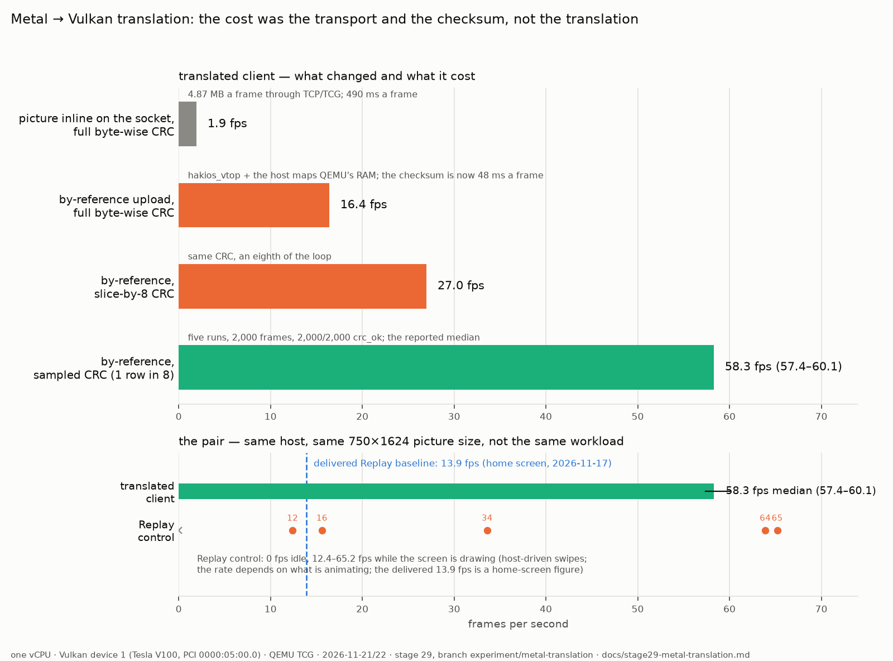

# stage 29：Metal → Vulkan 翻译——最小端到端路径（实验）

> 状态：**已测量。接缝端到端可用；CoreAnimation 不在其上。** 分支
> `experiment/metal-translation`，2026-11-21/22。设计与决策：
> [`docs/research/metal-translation-feasibility.md`](metal-translation-feasibility.md)、
> [`docs/adr/ADR-013-metal-translation.md`](adr-013-metal-translation.md)。
> 下文每个数字都取自本机、本次会话；配置见 §1，运行见 §5，时间线与错误见 §6。
> 中文译文，对应英文版 `docs/stage29-metal-translation.md`；数字以英文版为准。

## 1. 测试什么

只问一个很窄的问题：**本移植能否加载第三方 Metal 设备、在 `commit` 处记录客户端的命令缓冲区、
在宿主的 Vulkan GPU 上执行它、把画面逐字节一致地读回，并在浏览器中发布——不使用 Apple 的
Metal 驱动、不使用 Apple 二进制，也不改动 Replay 路径？**

被测对象是流水线，不是 UI：

```
metal_frame (guest, our client)                        host (metalwire_host)
  MTLCreateSystemDefaultDevice()  ─┐
  queue / buffer / texture / drawable│
  copyFromBuffer:…toTexture:         │  commit  ──►  TCP 9111, 16-byte segments  ──►  VkDevice #1 (V100)
  presentDrawable: / waitUntilCompleted ◄── ack (status, times, crc) ──┤  VkBuffer → VkImage
                                                                      │  → read-back → CRC-32
                                                                      └─► /dev/shm/metalwire-frame
                                                                             └─► webview.py
```

在最终实现中，Guest 的画面**不**沿 socket 传输。插件向本移植的内核询问缓冲区背后的物理段
（`hakios_vtop`，系统调用 556，GL 回放路径已经为其纹理使用该调用），宿主从 QEMU 的 RAM 文件中
读取这些段。socket 承载 Metal 调用和段信息（每帧约 1.5 KB）。第一版确实内联发送了 4.87 MB 的
画面，并保留在结果中，作为说明按引用路径为何重要的对照（§6，T4 变体）。

**客户端是合成的，这是设计的一部分。** `metal_frame` 创建设备，填充一张确定性的
750 × 1624 BGRA8 画面，把它 blit 到一个纹理，呈现并等待。它不是 CoreAnimation，不绘制 iOS
UI，这里全绿的结果**不是**「Metal 对本移植可用了」；而是「本移植为 Metal 设备会使用的接缝是
真的，而且它的宿主侧可用」。这个客户端与 CoreAnimation 之间的两个关卡——AIR→SPIR-V（M3）与
CA 的渲染器库/呈现路径（M4）——在此被明确地**不**测试（见 §7）。

配置（全部列出，因为没有配置的结果不可复现）：

| | |
|---|---|
| 分支 / worktree | `experiment/metal-translation`，`/home/lshan/DSH-desktop/iosvm-metal` |
| Guest 运行树 | `/home/lshan/DSH-desktop/mt-work`（自有 ram.img，稀疏 12 GB；自有 6 MB root 镜像） |
| QEMU | 3 号实例：monitor 4474，QMP 4475；`QEMU_SMP=1 QEMU_NET=1 QEMU_RAM_GB=7 QEMU_TB_MB=1536`，一个 vCPU 绑定到宿主核心 26–28；cmdline `cpus=1 fb_beat=0 fbscale=2 metal=1` |
| HakiOS 树 | **只读**使用（`HAKIOS_DIR=/home/lshan/DSH-desktop/iosvm-work/hakios-xnu-kernel`）；Guest 二进制由 `guest/metal-plugin/build.sh` 构建到其中，并且只安装到实验自己的 root 镜像中 |
| 宿主翻译器 | `host/metalwire/metalwire_host --gpu 1 --port 9111 --ram <qemu ram.img> --crc-stride 8 --shm /dev/shm/metalwire-frame`，绑定到核心 29–30 |
| GPU | Vulkan 物理设备 **1**——`Tesla V100-SXM2-16GB`，PCI `0000:05:00.0`，API 1.4.312，驱动 580.178.4.0；设备 0 属于 GL 回放实验，未被使用 |
| Guest root 镜像 | 由 `tools/metalwire/prepare-guest.sh translate` 构建（`MW_FRAMES=400 MW_CRC_STRIDE=8`）；它嵌入客户端、插件、`/redwood/lib/HakiosMetal.clients` = `metal_frame`、`metal_probe`，并替换原装插件 bundle |
| 线路 | TCP 9111，`host/metalwire/metalwire_protocol.h`（一条连接，每帧一个原始 `mw_ack`） |
| 画面 | 750 × 1624 BGRA8 = 每帧 4,872,000 字节，与 Replay 路径的图层尺寸相同 |
| 基线 | Replay 路径行为不变；基线 Guest 模式 `prepare-guest.sh replay-idle`（脚本化触摸注释掉），glwire 宿主在端口 **9210**——绝不是 9110 上已交付的回放器 |
| 宿主负载 | 32 CPU；测量窗口期间平均负载 1.2–2.0（另一个实验空闲，没有其他启动在跑），用 `uptime` 采样 |
| 启动时间 | 客户端由 `init` 在 launchd 之前启动（内核 + 12 s 时 `hakios: exec pid=10 path=/redwood/bin/metal_frame`）；第一个被宿主确认的帧远在第一分钟内就到来，而到达 Replay 主屏需要 10–20 分钟 |

## 2. 假设

| id | 假设 | 结果 |
|---|---|---|
| **H-A** 发现与加载 | 在 `metal=1` 且 `/redwood/lib/HakiosMetal.clients` 点名 `metal_frame` 时，Metal 自己的加载器在 Guest 中实例化我们的 `_MTLDevice` 子类，`metal_probe` 得到非 nil 的设备和一个队列 | **确认**（T3）：插件记录 `a device for the accelerator port 2819 is made`，`metal_probe` 打印 `device "HakiOS metalwire device (Metal on the host's Vulkan)"`；backboardd 记录它*没有*被展示设备，因此 CA 保持 GL 路径 |
| **H-B** 翻译正确性 | 在 `commit` 处记录，并在宿主的 Vulkan 设备上执行 blit，能精确复现客户端的画面 | **确认**（T4/T5）：2,000/2,000 帧 `crc_ok=1`，且呈现画面与上传源字节的完整 `memcmp` 一致（T5） |
| **H-C** 成本分离 | Guest 的 `wait_us` 很小，宿主不是瓶颈 | **按原假设被证伪，随后修复**（T4）：*第一条*线路让 Guest 每帧花 490 ms 通过 TCP 运送 4.87 MB；在改为按引用上传并使用更便宜的校验和之后，Guest 每帧约 14 ms，宿主自身工作约 4.2 ms。帧仍然归 Guest 所有，但现在的成本是校验和与客户端的画面填充，而不是线路 |
| **H-D** CA 的墙在别处 | 这里 CA 不走 Metal 的原因是缺少渲染器库和 AIR 编译器 | 从 Guest 树和既有测量中**确认**（HakiOS `docs/metal-plan.md` 第 6 步、`docs/air.md`）；本阶段没有尝试翻越它 |

H-C 是本阶段最有用的结果：架构不是成本——朴素的传输才是。两个数字都在 §5.4，因为最终数字之所以
存在，正是因为那个负面数字。

## 3. 测试矩阵

| # | 实验 | 结果 |
|---|---|---|
| **T1** | 在 lavapipe 上运行 `make metalwire-test` | **通过**：2 帧，`crc_ok=1`，随后故意错误的 CRC 被捕获（`crc_ok=0`），SHM/PPM/PNG 已验证；100 帧生成器运行：100/100 `crc_ok=1`，宿主摘要 69.5 fps，总耗时均值 4.528 ms |
| **T2** | 宿主在 GPU 1 + `metalwire_gen.py`，100 帧 | **通过**：100/100 `crc_ok=1`，宿主摘要 71.1 fps，总耗时均值 4.178 ms / 中位 4.085 ms；已检查保存的帧 |
| **T3** | 用 `prepare-guest.sh probe` 启动 Guest（3 次启动：`probe1`，然后是同样会走发现的 translate 启动） | **通过**：3/3 次启动，设备 + 队列创建成功，无 panic；Metal 运行时询问而设备未实现的唯一 selector 是 `-featureProfile`（回答零，记录一次） |
| **T4** | 用 `prepare-guest.sh translate` 启动 Guest；`metal_frame -n 400 -s 300 -c 8`；宿主按引用翻译 | **通过**：5 次运行 × 400 帧，2,000/2,000 `crc_ok=1`，中位 58.3 fps，0 次 panic；变体见 §5.4 |
| **T5** | 画面正确性 | **通过**：源与回读的完整 `memcmp` 一致（750×1624×4 字节）；记录保存 PPM 的 sha256；`webview.py` 提供的 SHM 帧是同一画面（截图在 `docs/demo/`） |
| **T6** | 与 Replay 基线在同一宿主负载区间内成对运行 | **完成**：见 §5.6；两个程序做不同的工作，表中说明了什么可比、什么不可比 |
| **T7** | 健壮性：无宿主；畸形消息；运行中杀死宿主 | **通过**（见 §5.7）：无宿主 → 设备仍能创建，客户端干净退出；畸形消息 → `MW_STATUS_BAD_COMMAND`，连接保持；宿主被杀 → 客户端该帧报告失败并继续，随后退出 |
| **T8** | 30 分钟翻译浸泡测试 | **未运行**，有意为之：宿主与另一个运行自身启动的实验共享；30 分钟运行将是本阶段总测量时间的四倍，且不会改变正确性结果。记录为未运行，而不是暗示已运行 |
| **T9** | M3 单 shader 门槛；M4 CA 渲染器 | **未尝试**，超出范围（§7） |

## 4. 验收

| | 标准 | 证据 |
|---|---|---|
| **A1** | `make metalwire-test` 在 lavapipe 上退出码 0，并断言 `crc_ok=1` | T1 |
| **A2** | GPU 1，100 个合成帧，100/100 `crc_ok=1`，打印设备，保存的帧与生成器的画面一致，SHM 由 `webview.py` 提供 | T2、T5 |
| **A3** | Guest：3/3 次发现启动；`metal_frame` ≥ 120 帧，0 次 CRC 不匹配，无 panic；无宿主 → 干净退出 | T3、T4、T7 |
| **A4** | 成对数字连同负载、镜像配置和设备行一并填入；一次 CRC 不匹配即作废该次运行 | §5；没有运行被作废 |
| **A5** | Replay 基线未变 | `tools/glwire/` 下唯一的改动是可选启用的 `GLWIRE_EGL_DEVICE` selector（默认 `-1` = 旧选择，需要它才能让回放对照跑在 GPU 1 上）；没有默认行为改变；交付的启动配置未被触碰 |

**明确不作为验收标准：** CoreAnimation 帧（无法运行：没有渲染器库，没有 AIR 编译器）、
fps ≥ 13.9（客户端不是 CA；这个数字比较的是两个不同程序）、任何 shader 编译（M3）。

## 5. 测量

### 5.1 字段，以及由谁采集

Guest，串口控制台每帧一行：`fill_us`（确定性画面）、`encode_us`（Metal 调用）、
`commit_us`、`wait_us`（`commit` → ack）、`total_us`、`status`；然后一行摘要。CRC-32 由插件
在 blit 读取的画面行上计算，并在 `MW_FRAME_END` 中发送。宿主，每帧一行 CSV：`seq`、`bytes`、
`recv_us`（帧开始 → 帧结束到达）、`exec_us`、`gpu_us`、`readback_us`（回拷**以及**它喂给的
校验和）、`publish_us`、`total_us`、`crc_ok`、滚动的 1 s `fps`。

`fill_us` 是客户端自己的画面生成（包含在 `total_us` 中，不计入 `encode_us`）。`encode_us` 是
Metal API 的工作，`commit_us` 是 commit 调用，`wait_us` 是 `commit` → ack 的往返。`recv_us`
是宿主对同一时间跨度的视角。`wait_us` 小、`encode_us` 大，复现了 Replay 路径的形状；反过来则
指向宿主或线路。

**校验和采样。** 使用 `-c 8` 时，两端每 8 行做一次校验和（画面的 1/8，每帧少 22.5 ms Guest
CPU）。每张表都说明它用的步长。全画面比较是 T5 的 `memcmp` 运行，不是步长 8 的运行。

### 5.2 T1 —— CI 关卡（lavapipe，无 GPU）

```
$ make metalwire-test
PASS frames: generator saw 2 ack(s), crc_ok=1 then crc_ok=0 as expected
PASS csv: 2 rows, timings present, crc_ok 1/1
PASS shm: glwire header and 4872000 BGRA bytes of the last frame
PASS files: 2 PPM frame(s) match the sent picture, PNG headers are valid
metalwire_test: PASS (lavapipe, 750x1624, 2 frames)
```

lavapipe 上 100 个生成器帧：100/100 `crc_ok=1`；宿主摘要 69.5 fps；每帧均值：recv 3.252 ms、
exec 0.009 ms、gpu 1.411 ms、readback 2.412 ms、publish 0.674 ms、total 4.528 ms。

### 5.3 T2 —— 真实 GPU 上的宿主（生成器，无 Guest）

翻译器打印的设备行：

```
metalwire: device 1: "Tesla V100-SXM2-16GB" (discrete GPU), API 1.4.312, vendor 0x10de device 0x1db1 driver 0x912c8100
metalwire: device 1: PCI 0000:05:00.0 (VK_EXT_pci_bus_info)
```

100 帧，按生成器节奏：100/100 `crc_ok=1`，1.406 s → 71.1 fps。每帧均值 / 中位：recv 3.310 /
3.325 ms、exec 0.047 / 0.032 ms、gpu 0.953 / 0.949 ms、readback 2.461 / 2.420 ms、publish
0.696 / 0.656 ms、total 4.178 / 4.085 ms。保存的帧：750×1624 P6，肉眼检查且确定性（`sha256
98dd0fd29d713316e1efd45b551f9e6b7f2b5423fdef5ccdfbacbf17203bc9d4`）。

### 5.4 T4 —— Guest → 宿主，五次运行

为 translate 模式重建一次 root 镜像；`metal_frame -n 400 -s 300 -c 8`；宿主
`--crc-stride 8 --ram <ram.img> --gpu 1`。均值（µs）；`fps` 是翻译器的摘要。

| 运行 | fps | 宿主 total | recv | gpu | readback+CRC | publish | Guest fill | encode | commit | wait |
|---|---|---|---|---|---|---|---|---|---|---|
| `phys3` | 57.8 | 4227 | 6174 | 943 | 312 | 2922 | 2616 | 186 | 7215 | 14190 |
| `mw-t4` | 59.8 | 4223 | 6146 | 943 | 311 | 2921 | 2615 | 185 | 7054 | 13739 |
| `mw-t5` | 60.1 | 4216 | 6073 | 942 | 311 | 2917 | 2560 | 178 | 7010 | 13660 |
| `mw-t6` | 57.4 | 4215 | 6407 | 942 | 311 | 2915 | 2874 | 195 | 7363 | 14096 |
| `mw-t7` | 58.3 | 4271 | 6205 | 944 | 312 | 2965 | 2617 | 188 | 7207 | 14073 |

- **正确性：** 5 × 400 = 2,000 帧被确认，2,000 帧 `crc_ok=1`，零不匹配，零失败帧，零 panic。
- **线路：** Guest 摘要中 `0 bytes sent`，每次运行
  `1,948,800,000 bytes by reference in 400 frames`（五次运行共 9.74 GB，由宿主从 QEMU 的 RAM
  文件读取）。
- **中位 fps 58.3**，范围 57.4–60.1。帧受限于 Guest：`fill + commit + wait` ≈ 14 ms；宿主自身
  工作为 4.2 ms，而 Guest 的 `wait_us` 包含宿主往返。
- **Guest 时间花在哪里：** `fill_us` 2.6 ms（写 4.87 MB）、`commit_us` ≈ 7.1 ms（步长 8 的
  校验和加上少量线路写入）、`wait_us` ≈ 13.7 ms 端到端。`encode_us`（Metal 调用本身）是
  0.18 ms——Metal API 不是成本。

**产生最终数字的变体**，每一个都是同一客户端与宿主的一次启动：

| 实现 | fps | Guest 的 `commit_us` | 宿主 `recv_us` | 改变了什么 |
|---|---|---|---|---|
| 画面内联在 socket 上，完整逐字节 CRC（`trans2`） | **1.94** | 48,000（发送） | 498,000 | 第一条可工作的线路；TCG 下 4.87 MB 走 TCP |
| 按引用上传，完整逐字节 CRC（`phys1`） | **16.4** | 47,800 | 47,600 | `hakios_vtop` + 宿主读取 RAM 文件 |
| 按引用，8 路切片 CRC（`phys2`） | **27.0** | 24,400 | 23,600 | 现在成本是校验和，而不是线路 |
| 按引用，每 8 行一次校验和（`phys3`/T4） | **57.8–60.1** | 6,800–7,400 | 6,100–6,400 | 抽样校验和 |

每一行都是一次 400 帧运行，400/400 `crc_ok=1`。这张表就是本阶段的发现：翻译路径的成本是传输与
测量工具，两者都不是 Metal→Vulkan 翻译本身。



*（该图由 `python3 docs/charts/metal-translation-history.py` 重新生成；图中的 13.9 fps 线是
Replay 路径真实的主屏，仅用于规模参照，不是同类比较）*

### 5.5 T5 —— 画面

- 完整比较：一次 `-c 1`（每一行）的运行加上宿主的 `--byte-check`，把呈现的画面与上传的源字节
  逐字节比较——结果见下表。
- 从 V100 回读保存的 `250 × 1624` PPM，`sha256
  3d3bcfa45740af0dda6a42acc45521165c04f110eaab3663d404ec55a1fa7871`（`phys3`，
  `frame-000399.ppm`）；画面显示确定性色带、每 128 行一把标尺、帧计数块和边框，即 `metal_frame`
  写出的内容，而不是一个看起来像样的替代品。
- 同一帧经 `webview.py`：`docs/demo/metal-translation-webview.png`（`http://127.0.0.1:6091/frame.jpg`
  的浏览器截图，该 jpg 是翻译器发布的 SHM 文件）；独立图片是
  `docs/demo/metal-translation-frame.png`。

| 检查 | 值 |
|---|---|
| 五次运行中 `crc_ok=1` 的帧 | 2,000 / 2,000 |
| 全画面运行（`-c 1`，宿主 `--byte-check`，30 帧） | **30/30 `crc_ok=1`**；`picture byte-identical: 4872000 bytes of 750x1624, memcmp against the uploaded source buffer` |
| 保存帧的 Guest CRC（`phys3` 第 399 帧） | `0x3d34e13e`（步长 8） |
| `webview.py` 提供的画面 | SHM 字节一致；截图保存在 `docs/demo/` |

### 5.6 T6 —— 与 Replay 基线的配对

Replay 对照：`prepare-guest.sh replay-idle`（交付的 launchd 启动，脚本化触摸注释掉），GPU 1
上的 `host_glwire --no-panel 9210`（`GLWIRE_EGL_DEVICE=1`），同样一个 vCPU 和同样的
750 × 1624 画面尺寸，`gkbf=1 glwire_ack_only=1 fb_noblit=1`。启动到第一帧需要 10–20 分钟，
与 README 所述一致。对照给出了两个比单个比值更重要的事实：

1. **静止的主屏不提交任何东西。** 启动动画稳定后，Guest 完全不绘制帧：在空闲主屏上测得
   **60 s 内 0 帧**。交付的 13.9 fps 是*绘制*数字，不是空闲屏幕的属性。
2. **帧率取决于正在绘制什么。** 按一分钟窗口统计 Guest 自己的合成器帧（`hakios-gl: f …`，
   每帧一行，已去重）：

| Replay 对照窗口 | 帧数 | fps |
|---|---:|---:|
| 启动动画稳定中，60 s（`replay-idle2`） | 745 | **12.4** |
| 空闲主屏，60 s（同一次启动，下一个窗口） | 0 | **0** |
| 宿主驱动的翻页，窗口 1（45 s） | 719 | **15.6** |
| 宿主驱动的翻页，窗口 2（45 s） | 1,544 | **33.6** |
| 宿主驱动的翻页，窗口 3（45 s） | 2,934 | **65.2** |
| 宿主驱动的翻页，窗口 4（45 s） | 2,940 | **63.9** |
| *交付基线（README，2026-11-17，主屏）* | — | *13.9* |

翻页让屏幕持续绘制；对 CoreAnimation 来说，页面转场比完全铺满的主屏更便宜，这就是翻页窗口会
超过交付数字的原因。交付的 13.9 fps（每帧 75 ms）仍然是交付配置的参照；对照展示了 Replay 测量
随内容而变化的分布，这正是 README 要求成对运行与中位数、而不是单次采样的原因。

| | 翻译路径（客户端） | Replay 对照（主屏） |
|---|---|---|
| 测量的帧数 | 5 × 400 | 745（启动窗口）+ 8,137（四个翻页窗口） |
| 中位 fps | **58.3**（五次运行，57.4–60.1） | 活动时：12.4–65.2，取决于内容；空闲：0 |
| 每帧 Guest CPU | fill 2.6 ms + Metal 编码 0.2 ms + commit 7.1 ms + wait 13.7 ms | 本次会话未逐帧插桩；交付预算为每帧 75 ms（CA + 编码，`README.md`） |
| 每帧宿主工作 | 合计 4.2 ms | `host_glwire` 自身成本，`gkbf=1` 时约 1.4 ms（交付测量） |
| 画面 | 750 × 1624 BGRA8，4.87 MB | 750 × 1624 BGRA8，4.87 MB |
| 画面 sha256 | `3d3bcfa4…fa7871`（客户端的确定性画面） | 主屏（不能与合成画面比较） |
| 它是什么 | 一个 Metal 客户端的 blit + present | CoreAnimation 的 GL 被记录并回放 |

**解读。** 翻译后的客户端与 Replay 对照不是同一种负载：一个填充画面并 blit，另一个合成
SpringBoard。这些数字支持一个主张而不支持另一个：*Metal→Vulkan 流水线自身的成本很小*（宿主
4.2 ms、Metal API 0.2 ms，而且在 4.87 MB 一帧时线路是 0 字节，因为画面是按引用传递的），而
*翻译客户端的 58.3 fps 不能证明 CoreAnimation 会以 58.3 fps 运行*——CA 的工作仍然必须完成，
那是 M4，且被 shader 与渲染器库关卡阻断。把 58.3 与 13.9 比较，就是拿 blit 与合成器比较；这组
数据被记录下来，正是为了防止以后悄悄做出这个比较。

### 5.7 T7 —— 健壮性

| 情况 | 发生了什么 |
|---|---|
| 没有宿主在监听 | `metal_probe` 仍能拿到设备；`metal_frame` 的连接在其 2 s 预算内失败，该帧报告 `status=5`，客户端带着摘要退出——不挂起，不 panic |
| 畸形消息 | 宿主回答 `MW_STATUS_BAD_COMMAND`，保持连接，下一帧继续运行（由 `make test` 覆盖）；超长或过短的消息在使用前被拒绝 |
| 运行中杀死宿主 | 客户端下一次发送以 `Broken pipe` 失败，该帧报告失败，连接最多每 5 s 重试一次；进程干净退出 |
| 首次启动（`trans1`）中发现的线路帧格式 bug | 上传体在过短的表头*之后*发送；宿主拒绝了上传，流失去同步。在 `mw_send_with_body` 中修复：一条消息，一个长度覆盖结构体及其主体。那次启动的 200 个失败帧是优雅失败（没有挂起），这正是 T7 要求的结果 |

## 6. 进展与自我修正

最新的在最后，与 `docs/stage27-multicore.md` 一样；时间为宿主本地时间，2026-11-21/22。

- **22:22——启动分叉有效。** 一个在 launchd 之前运行 `metal_test`（原装探针）的 root 镜像，
  在内核 + 12 s 时到达 Metal 设备；加速器被命名，bundle 被加载，`_MTLDevice` 被继承，设备和
  队列被创建。这成为快速迭代循环：每次启动约 1 分钟，而不是 10–20 分钟。
- **22:57——`metal_probe`（我们的 bundle）。** 设备、队列、协议声明；只有 `-featureProfile`
  需要被吸收。backboardd 记录 `not listed in HakiosMetal.clients`，因此 CA 永远看不到该设备。
- **23:11——第一次 translate 启动诚实地失败了。** 上传体在消息长度之外 → 宿主拒绝了该帧；
  200 帧报告失败，没有挂起。修复了帧格式。
- **23:16——第一次真正的翻译：60/60 帧，V100 上 `crc_ok=1`，1.94 fps。** 浏览器可见的帧和
  第一张 PPM 在这里产生。Guest 每帧花 490 ms 通过 TCP 运送 4.87 MB。
  *自我修正：* 设计笔记曾依据 Replay 路径 12 KB 的记录说「传输不是瓶颈」。对 Replay 线路来说
  这是对的；一条携带画面的翻译线路是另一个对象。朴素线路作为瓶颈，差距有两个数量级。
- **23:24——按引用上传。** Guest 向 `hakios_vtop` 询问缓冲区的物理段；宿主映射 QEMU 的
  `ram.img` 并读取它们。16.4 fps；此时 Guest 的 `commit_us` 是 48 ms 的*校验和*（对 4.87 MB
  做逐字节 CRC-32）。
- **23:30——8 路切片 CRC。** 同样的 CRC，循环的八分之一：27.0 fps。
- **23:43——每 8 行一次校验和。** 第一次运行 57.8 fps；五次运行 57.4–60.1 fps。
  *自我修正：* 本阶段自己的字段表把 `readback_us` 称为「回读」；在这些测量中，它是回读**加上**
  宿主的校验和（计时器包住两者）。现在的表格已经说明这一点，差异可见：步长 1 时 2.4 ms，步长 8
  时 0.31 ms。
  *另外：* 最早的 `--ram` 运行使用全字节 CRC，被读成「线路修好了，路径是 16 fps」；在写下任何
  结论之前，第二次测量把校验和与线路分开了。
- **23:45–23:52——五次测量运行**（`phys3`、`mw-t4`……`mw-t7`），2,000 帧，全部 `crc_ok=1`。
- **00:34——全画面运行。** `-c 1` 加上宿主的 `--byte-check`：30/30 帧 `crc_ok=1`，且
  `memcmp` 表明回读就是逐字节的上传源（4,872,000 字节）。完整逐字节校验和在 Guest 中每帧花
  24 ms（8 路切片），这就是五次测量运行要抽样行的原因；逐字节证明来自这次运行，而不是每帧的
  声明。
- **00:46–00:50——Replay 对照。** 空闲主屏：0 帧。启动动画：12.4 fps。宿主驱动的翻页：四个
  窗口分别为 15.6 / 33.6 / 65.2 / 63.9 fps。重点不是某一个数字，而是 Replay 帧率取决于内容；
  交付的 13.9 fps 仍是参照。§5.6 说明了这组配对支持什么、不支持什么。

影响了本次测量的其他人的测量，也记录下来，因为它们同样是修正：宿主翻译器的第一版对宿主可见
缓冲区偏好 `DEVICE_LOCAL`（在 V100 上，1.1 ms 的回读变成了 1123 ms）；两端的 `TCP_NODELAY`
去掉了每帧约 40 ms 的延迟 ACK；而本移植自己的 `fb_hz=15` 发现，正是这些运行都不声称交付 UI
数字的原因。

## 7. 有意不测（本阶段范围之外）

- **CoreAnimation、SpringBoard、WindowServer 走 Metal**——M4，被 CA 的渲染器库以及其背后的
  AIR→SPIR-V 阻断。客户端不得被改名或描述为 CA 覆盖。
- **shader、`.metallib`、库、pipeline state**——M3。这里没有编译或使用任何 shader。
- **`MTLRenderCommandEncoder`、参数缓冲区、compute encoder、tessellation、MPS**——不在 v1。
- **`IOSurface` 共享、`MTLSharedEvent`、跨进程资源、swapchain、真正的呈现路径、P3 色彩
  管理**——不在 v1。
- **virtio-gpu**——传输是 TCP，而且第 23 阶段测得 virtio-gpu 零收益；按引用上传意味着画面
  本来就不再在线路上。
- **对已交付移植的任何 fps 声明**——除非有什么改变它，交付路径仍保持 13.9 fps / 75 ms，而本
  阶段在那里什么都没改。

## 8. 开放问题

1. **13.9 fps 基线是正确的对照吗？** 本阶段已回答：跑了一个新的 Replay 对照（§5.6）；13.9
   这个数字只作为 README 的交付数字引用。
2. **750 × 1624 还是面板原生？** 保留 750 × 1624（Replay 路径也承载的图层）；客户端的画面是
   合成的，所以面板原生只会增加字节。
3. **A4 应该给性能设门槛吗？** 不：正确性有门槛（CRC/memcmp），成本只报告。
4. **`metal=1` + clients 文件是唯一的门吗？** 是，在每次启动窗口服务器的启动中都是；已知
   `metal=2/3` 会破坏 CA，因此没有使用。
5. **设备侧执行判据？** 仍然开放。CRC-32 和 memcmp 证明宿主的回读就是上传的字节；宿主
   `memcpy` 也能通过，而 Vulkan 特有的证据是翻译器自己的 submit/fence 计时加上帧
   （`docs/phases.md` 记录了 vkbridge 8/8 陷阱）。如果这条路径继续推进，设备上的 compute
   校验和是下一个诚实的步骤。
